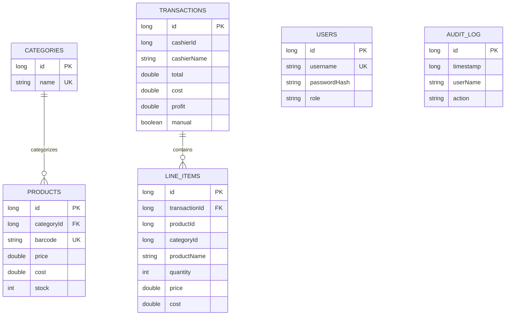
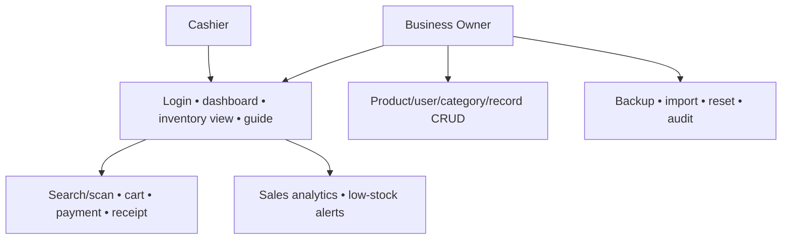
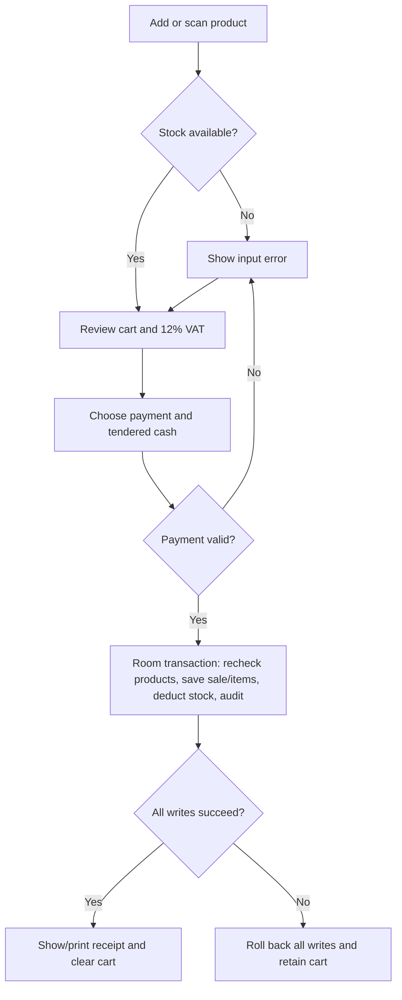

# System Design

## Entity relationships

`cashierId`, `productId`, and the category ID on a receipt are historical snapshots rather than delete-cascading live references. This permits removal of live users/products without corrupting past receipts. Categories used by lines remain protected by repository validation. The explicit foreign keys are products→categories (RESTRICT) and lines→transactions (CASCADE). Unique indexes protect usernames, category names, and product barcodes. Dates and audit timestamps are indexed.

## Use cases

## Checkout flow

## Mutation and failure rules

All database operations occur off the main thread. Critical multi-record writes use `withTransaction`. Checkout refreshes products and verifies stock and price snapshots before writing. Failed cash validation or stock checks cannot leave partial sales. Sale deletion restores existing products and cascades line deletion. Import validates the complete input, then replaces all tables atomically in foreign-key-safe order. Export reads all six tables in a consistent transaction. DAO insertion uses ABORT rather than silent replacement.

Repository methods re-read the logged-in user and enforce owner rights. UI visibility is an additional convenience, not the authorization boundary. At least one owner must remain, and the active owner cannot delete or demote their own account.
