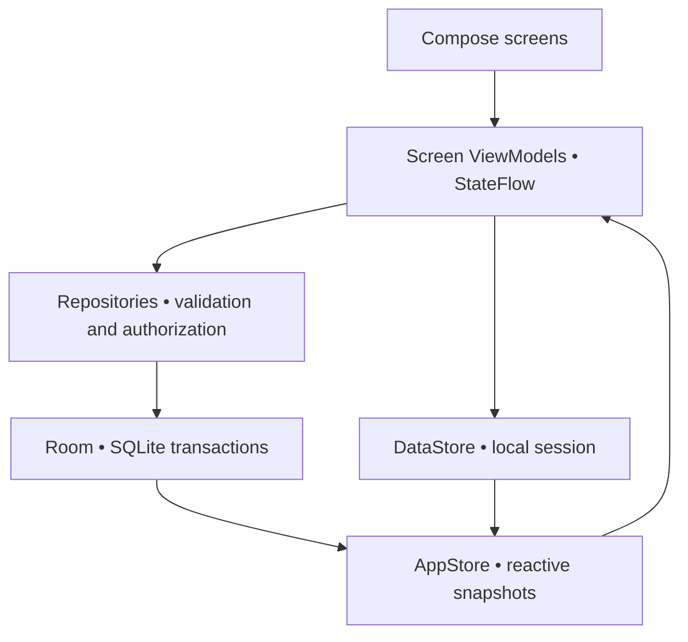
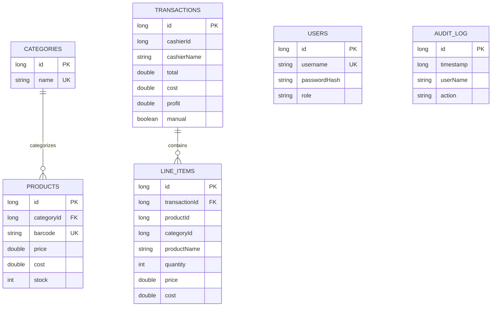
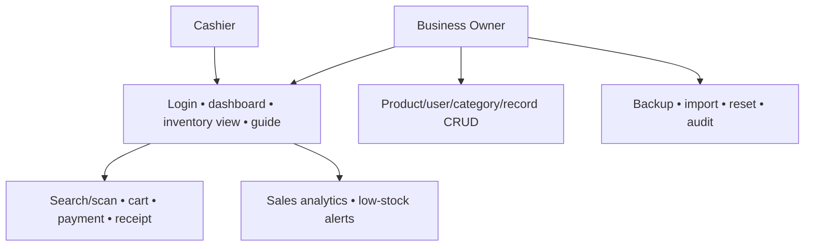
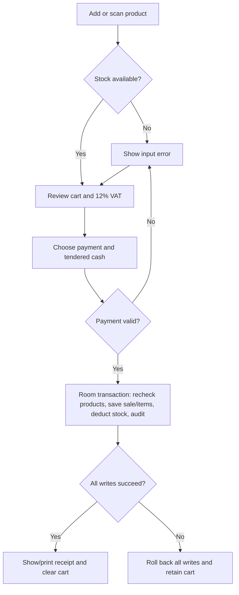

# BizPulse: complete source listings

The actual editable files accompany this full-text reference. The Gradle wrapper JAR and APKs are binary files included in the archive.

## Section 1: Overview and setup instructions

Extract the archive, open the BizPulse root folder in Android Studio, select JDK 17, install SDK 34, sync Gradle, and run the app. See README.md and PROJECT-GUIDE.md for full setup instructions.

## Section 2: Gradle configuration files


#### settings.gradle.kts

````kotlin
pluginManagement { repositories { google(); mavenCentral(); gradlePluginPortal() } }
dependencyResolutionManagement {
    repositoriesMode.set(RepositoriesMode.FAIL_ON_PROJECT_REPOS)
    repositories { google(); mavenCentral() }
}
rootProject.name = "BizPulse"
include(":app")
````


#### build.gradle.kts

````kotlin
plugins {
    id("com.android.application") version "8.2.2" apply false
    id("org.jetbrains.kotlin.android") version "1.9.22" apply false
    id("org.jetbrains.kotlin.kapt") version "1.9.22" apply false
    id("com.google.dagger.hilt.android") version "2.50" apply false
}
````


#### gradle.properties

````text
org.gradle.jvmargs=-Xmx2048m -Dfile.encoding=UTF-8
android.useAndroidX=true
kotlin.code.style=official
android.nonTransitiveRClass=true
kapt.incremental.apt=true
````


#### app/build.gradle.kts

````kotlin
plugins {
    id("com.android.application")
    id("org.jetbrains.kotlin.android")
    id("org.jetbrains.kotlin.kapt")
    id("com.google.dagger.hilt.android")
}
android {
    namespace = "com.bizpulse.app"
    compileSdk = 34
    defaultConfig {
        applicationId = "com.bizpulse.app"
        minSdk = 26
        targetSdk = 34
        versionCode = 1
        versionName = "1.0.0"
        testInstrumentationRunner = "androidx.test.runner.AndroidJUnitRunner"
    }
    buildTypes { release { isMinifyEnabled = false; proguardFiles(getDefaultProguardFile("proguard-android-optimize.txt"), "proguard-rules.pro") } }
    compileOptions { sourceCompatibility = JavaVersion.VERSION_17; targetCompatibility = JavaVersion.VERSION_17 }
    kotlinOptions { jvmTarget = "17" }
    buildFeatures { compose = true }
    composeOptions { kotlinCompilerExtensionVersion = "1.5.8" }
    packaging { resources.excludes += "/META-INF/{AL2.0,LGPL2.1}" }
    testOptions { unitTests.isReturnDefaultValues = true }
}
kapt { correctErrorTypes = true }
dependencies {
    val composeBom = platform("androidx.compose:compose-bom:2024.02.02")
    implementation(composeBom)
    androidTestImplementation(composeBom)
    implementation("androidx.core:core-ktx:1.12.0")
    implementation("androidx.activity:activity-compose:1.8.2")
    implementation("androidx.lifecycle:lifecycle-runtime-compose:2.7.0")
    implementation("androidx.lifecycle:lifecycle-viewmodel-compose:2.7.0")
    implementation("androidx.lifecycle:lifecycle-viewmodel-ktx:2.7.0")
    implementation("androidx.compose.ui:ui")
    implementation("androidx.compose.ui:ui-tooling-preview")
    implementation("androidx.compose.material3:material3")
    implementation("androidx.compose.material:material-icons-extended")
    implementation("androidx.navigation:navigation-compose:2.7.7")
    implementation("androidx.hilt:hilt-navigation-compose:1.1.0")
    implementation("com.google.dagger:hilt-android:2.50")
    kapt("com.google.dagger:hilt-compiler:2.50")
    implementation("androidx.room:room-runtime:2.6.1")
    implementation("androidx.room:room-ktx:2.6.1")
    kapt("androidx.room:room-compiler:2.6.1")
    implementation("androidx.datastore:datastore-preferences:1.0.0")
    implementation("org.jetbrains.kotlinx:kotlinx-coroutines-android:1.7.3")
    implementation("com.journeyapps:zxing-android-embedded:4.3.0")
    testImplementation("junit:junit:4.13.2")
    androidTestImplementation("androidx.test.ext:junit:1.1.5")
    androidTestImplementation("androidx.test:runner:1.5.2")
    androidTestImplementation("androidx.test:rules:1.5.0")
    androidTestImplementation("androidx.compose.ui:ui-test-junit4")
    androidTestImplementation("androidx.room:room-testing:2.6.1")
    debugImplementation("androidx.compose.ui:ui-tooling")
    debugImplementation("androidx.compose.ui:ui-test-manifest")
}
````


#### gradle/wrapper/gradle-wrapper.properties

````text
distributionBase=GRADLE_USER_HOME
distributionPath=wrapper/dists
distributionUrl=https\://services.gradle.org/distributions/gradle-8.2-bin.zip
networkTimeout=60000
validateDistributionUrl=true
zipStoreBase=GRADLE_USER_HOME
zipStorePath=wrapper/dists
````


#### gradlew

````text
#!/bin/sh
APP_HOME=$(CDPATH= cd -- "$(dirname -- "$0")" && pwd)
if [ -n "$JAVA_HOME" ]; then JAVACMD="$JAVA_HOME/bin/java"; else JAVACMD=java; fi
exec "$JAVACMD" -classpath "$APP_HOME/gradle/wrapper/gradle-wrapper.jar" org.gradle.wrapper.GradleWrapperMain "$@"
````


#### gradlew.bat

````text
@echo off
setlocal
set "APP_HOME=%~dp0"
set "JAVA_EXE=java.exe"
if defined JAVA_HOME set "JAVA_EXE=%JAVA_HOME%\bin\java.exe"
"%JAVA_EXE%" -classpath "%APP_HOME%gradle\wrapper\gradle-wrapper.jar" org.gradle.wrapper.GradleWrapperMain %*
exit /b %ERRORLEVEL%
````


## Section 3: Android manifest and resources


#### app/src/main/AndroidManifest.xml

````xml
<manifest xmlns:android="http://schemas.android.com/apk/res/android">
    <uses-permission android:name="android.permission.CAMERA" />
    <uses-feature android:name="android.hardware.camera" android:required="false" />
    <application android:name=".BizPulseApplication" android:allowBackup="false"
        android:dataExtractionRules="@xml/data_extraction_rules" android:fullBackupContent="@xml/backup_rules"
        android:icon="@mipmap/ic_launcher" android:roundIcon="@mipmap/ic_launcher_round"
        android:label="@string/app_name" android:supportsRtl="true" android:theme="@style/Theme.BizPulse">
        <activity android:name=".MainActivity" android:exported="true" android:windowSoftInputMode="adjustResize">
            <intent-filter><action android:name="android.intent.action.MAIN"/><category android:name="android.intent.category.LAUNCHER"/></intent-filter>
        </activity>
        <provider android:name="androidx.core.content.FileProvider" android:authorities="${applicationId}.fileprovider" android:exported="false" android:grantUriPermissions="true">
            <meta-data android:name="android.support.FILE_PROVIDER_PATHS" android:resource="@xml/file_paths"/>
        </provider>
    </application>
</manifest>
````


#### app/proguard-rules.pro

````text
# No reflection-based entity serialization: JSON fields are written explicitly.
-keepattributes Signature,InnerClasses,EnclosingMethod
````


#### app/src/main/res/drawable/ic_launcher_foreground.xml

````xml
<vector xmlns:android="http://schemas.android.com/apk/res/android" android:width="108dp" android:height="108dp" android:viewportWidth="108" android:viewportHeight="108"><path android:fillColor="#10B981" android:pathData="M28,68 L28,48 L40,48 L40,68 Z M48,68 L48,36 L60,36 L60,68 Z M68,68 L68,27 L80,27 L80,68 Z"/></vector>
````


#### app/src/main/res/mipmap-anydpi-v26/ic_launcher.xml

````xml
<adaptive-icon xmlns:android="http://schemas.android.com/apk/res/android"><background android:drawable="@color/navy"/><foreground android:drawable="@drawable/ic_launcher_foreground"/></adaptive-icon>
````


#### app/src/main/res/mipmap-anydpi-v26/ic_launcher_round.xml

````xml
<adaptive-icon xmlns:android="http://schemas.android.com/apk/res/android"><background android:drawable="@color/navy"/><foreground android:drawable="@drawable/ic_launcher_foreground"/></adaptive-icon>
````


#### app/src/main/res/values/colors.xml

````xml
<resources><color name="emerald">#10B981</color><color name="navy">#0F172A</color></resources>
````


#### app/src/main/res/values/strings.xml

````xml
<resources><string name="app_name">BizPulse</string></resources>
````


#### app/src/main/res/values/themes.xml

````xml
<resources><style name="Theme.BizPulse" parent="android:style/Theme.Material.Light.NoActionBar"><item name="android:fontFamily">sans</item><item name="android:windowLightStatusBar">true</item><item name="android:colorAccent">@color/emerald</item><item name="android:windowActionModeOverlay">true</item></style></resources>
````


#### app/src/main/res/xml/backup_rules.xml

````xml
<full-backup-content><exclude domain="root" path="."/><exclude domain="database" path="."/><exclude domain="file" path="."/><exclude domain="sharedpref" path="."/></full-backup-content>
````


#### app/src/main/res/xml/data_extraction_rules.xml

````xml
<data-extraction-rules><cloud-backup><exclude domain="root" path="."/><exclude domain="database" path="."/><exclude domain="file" path="."/><exclude domain="sharedpref" path="."/></cloud-backup><device-transfer><exclude domain="root" path="."/><exclude domain="database" path="."/><exclude domain="file" path="."/><exclude domain="sharedpref" path="."/></device-transfer></data-extraction-rules>
````


#### app/src/main/res/xml/file_paths.xml

````xml
<paths xmlns:android="http://schemas.android.com/apk/res/android"><cache-path name="backups" path="backups/"/></paths>
````


## Section 4: Data layer


#### app/src/main/java/com/bizpulse/app/data/db/BizPulseDatabase.kt

````kotlin
package com.bizpulse.app.data.db
import android.content.Context
import androidx.room.*
import androidx.sqlite.db.SupportSQLiteDatabase
import com.bizpulse.app.data.db.dao.*
import com.bizpulse.app.data.db.entity.*
@Database(entities = [UserEntity::class, CategoryEntity::class, ProductEntity::class, TransactionEntity::class, LineItemEntity::class, AuditLogEntity::class], version = 1, exportSchema = false)
@TypeConverters(Converters::class)
abstract class BizPulseDatabase : RoomDatabase() {
    abstract fun users(): UserDao
    abstract fun categories(): CategoryDao
    abstract fun products(): ProductDao
    abstract fun transactions(): TransactionDao
    abstract fun lines(): LineItemDao
    abstract fun audit(): AuditLogDao
    companion object {
        @Volatile private var instance: BizPulseDatabase? = null
        fun getInstance(context: Context): BizPulseDatabase = instance ?: synchronized(this) {
            instance ?: Room.databaseBuilder(context.applicationContext, BizPulseDatabase::class.java, "bizpulse.db")
                .addCallback(object : Callback() {
                    override fun onCreate(db: SupportSQLiteDatabase) { DatabaseSeeder.seed(db) }
                }).build().also { instance = it }
        }
    }
}
````


#### app/src/main/java/com/bizpulse/app/data/db/Converters.kt

````kotlin
package com.bizpulse.app.data.db
import androidx.room.TypeConverter
import java.time.LocalDate
class Converters {
    @TypeConverter fun dateToString(date: LocalDate?): String? = date?.toString()
    @TypeConverter fun stringToDate(value: String?): LocalDate? = value?.let(LocalDate::parse)
}
````


#### app/src/main/java/com/bizpulse/app/data/db/DatabaseSeeder.kt

````kotlin
package com.bizpulse.app.data.db
import androidx.sqlite.db.SupportSQLiteDatabase
import com.bizpulse.app.util.*
import java.time.LocalDate
/** Callback runs inside database creation; raw inserts avoid recursively reopening Room. */
object DatabaseSeeder {
    fun seed(db: SupportSQLiteDatabase) {
        val now = System.currentTimeMillis()
        val users = listOf(listOf("Maria Santos","owner","owner123","owner"), listOf("Juan Dela Cruz","cashier","cashier123","cashier"), listOf("Ana Reyes","ana","ana123","cashier"))
        users.forEachIndexed { i, u -> db.execSQL("INSERT INTO users(id,name,username,passwordHash,role,createdAt) VALUES(?,?,?,?,?,?)", arrayOf(i+1,u[0],u[1],PasswordHasher.hash(u[2]),u[3],now)) }
        listOf("Beverages","Snacks","Grocery","Personal Care").forEachIndexed { i,n -> db.execSQL("INSERT INTO categories(id,name,description) VALUES(?,?,?)",arrayOf(i+1,n,"")) }
        data class Seed(val name:String,val barcode:String,val price:Double,val cost:Double,val stock:Int,val min:Int,val cat:Int)
        val products = listOf(
            Seed("Beverage - Cola 1.5L","4801234567890",89.0,55.0,42,10,1),
            Seed("Snack - Potato Chips","4809876543210",45.0,28.0,8,10,2),
            Seed("Grocery - Rice 5kg","4805551234567",250.0,190.0,23,5,3),
            Seed("Personal Care - Shampoo","4802223334444",120.0,80.0,4,6,4),
            Seed("Beverage - Bottled Water","4803334445555",25.0,12.0,60,15,1),
            Seed("Snack - Chocolate Bar","4804445556666",35.0,20.0,3,8,2),
            Seed("Grocery - Cooking Oil 1L","4806667778888",95.0,65.0,18,5,3),
            Seed("Beverage - Energy Drink","4807778889999",55.0,35.0,27,8,1),
            Seed("Snack - Biscuits Pack","4808889990000",30.0,18.0,45,12,2),
            Seed("Grocery - Sugar 1kg","4809990001111",65.0,45.0,33,10,3))
        products.forEachIndexed { i,p -> db.execSQL("INSERT INTO products(id,name,barcode,price,cost,stock,minAlert,categoryId,createdAt) VALUES(?,?,?,?,?,?,?,?,?)",arrayOf(i+1,p.name,p.barcode,p.price,p.cost,p.stock,p.min,p.cat,now)) }
        // Stock above is the opening balance AFTER these historical example sales.
        repeat(6) { i ->
            val a=products[i]; val b=products[(i+4)%10]; val subtotal=rounded(a.price*2+b.price)
            val total=rounded(subtotal+rounded(subtotal*0.12)); val cost=rounded(a.cost*2+b.cost)
            db.execSQL("INSERT INTO transactions(id,date,time,total,items,payment,cashierName,cashierId,cost,profit,createdAt,manual,tendered) VALUES(?,?,?,?,?,?,?,?,?,?,?,?,?)",arrayOf(i+1,LocalDate.now().minusDays((5-i).toLong()).toString(),"10:30",total,3,"Cash","Juan Dela Cruz",2,cost,rounded(total-cost),now-(5-i)*86400000L,0,total))
            listOf(Triple(i,a,2),Triple((i+4)%10,b,1)).forEach { (index,p,q) -> db.execSQL("INSERT INTO line_items(transactionId,productId,productName,quantity,price,cost,categoryId) VALUES(?,?,?,?,?,?,?)",arrayOf(i+1,index+1,p.name,q,p.price,p.cost,p.cat)) }
        }
        listOf("Login","Sale","Product Updated","Sale").forEachIndexed { i,a -> db.execSQL("INSERT INTO audit_log(timestamp,userName,action,details,type) VALUES(?,?,?,?,?)",arrayOf(now-i*60000,"Demo",a,"Seed example record",if(a=="Login") "auth" else if(a=="Sale") "sale" else "update")) }
    }
}
````


#### app/src/main/java/com/bizpulse/app/data/db/dao/AuditLogDao.kt

````kotlin
package com.bizpulse.app.data.db.dao
import androidx.room.*
import kotlinx.coroutines.flow.Flow
import com.bizpulse.app.data.db.entity.AuditLogEntity
@Dao interface AuditLogDao {
    @Insert suspend fun insert(row: AuditLogEntity): Long
    @Update suspend fun update(row: AuditLogEntity)
    @Delete suspend fun delete(row: AuditLogEntity)
    @Query("SELECT * FROM audit_log ORDER BY timestamp DESC") fun getAll(): Flow<List<AuditLogEntity>>
    @Query("SELECT * FROM audit_log ORDER BY timestamp DESC") suspend fun snapshot(): List<AuditLogEntity>
    @Query("SELECT * FROM audit_log WHERE id = :id") suspend fun getById(id: Long): AuditLogEntity?
    @Query("DELETE FROM audit_log") suspend fun clear()
    @Query("SELECT * FROM audit_log WHERE action LIKE '%' || :term || '%' OR details LIKE '%' || :term || '%' OR userName LIKE '%' || :term || '%' ORDER BY timestamp DESC") fun search(term: String): Flow<List<AuditLogEntity>>
    @Query("SELECT * FROM audit_log ORDER BY timestamp DESC LIMIT :limit") fun getRecent(limit: Int): Flow<List<AuditLogEntity>>
}
````


#### app/src/main/java/com/bizpulse/app/data/db/dao/CategoryDao.kt

````kotlin
package com.bizpulse.app.data.db.dao
import androidx.room.*
import kotlinx.coroutines.flow.Flow
import com.bizpulse.app.data.db.entity.CategoryEntity
@Dao interface CategoryDao {
    @Insert suspend fun insert(row: CategoryEntity): Long
    @Update suspend fun update(row: CategoryEntity)
    @Delete suspend fun delete(row: CategoryEntity)
    @Query("SELECT * FROM categories ORDER BY id") fun getAll(): Flow<List<CategoryEntity>>
    @Query("SELECT * FROM categories ORDER BY id") suspend fun snapshot(): List<CategoryEntity>
    @Query("SELECT * FROM categories WHERE id = :id") suspend fun getById(id: Long): CategoryEntity?
    @Query("DELETE FROM categories") suspend fun clear()
    
}
````


#### app/src/main/java/com/bizpulse/app/data/db/dao/LineItemDao.kt

````kotlin
package com.bizpulse.app.data.db.dao
import androidx.room.*
import kotlinx.coroutines.flow.Flow
import com.bizpulse.app.data.db.entity.LineItemEntity
@Dao interface LineItemDao {
    @Insert suspend fun insert(row: LineItemEntity): Long
    @Update suspend fun update(row: LineItemEntity)
    @Delete suspend fun delete(row: LineItemEntity)
    @Query("SELECT * FROM line_items ORDER BY id") fun getAll(): Flow<List<LineItemEntity>>
    @Query("SELECT * FROM line_items ORDER BY id") suspend fun snapshot(): List<LineItemEntity>
    @Query("SELECT * FROM line_items WHERE id = :id") suspend fun getById(id: Long): LineItemEntity?
    @Query("DELETE FROM line_items") suspend fun clear()
    @Insert suspend fun insert(rows: List<LineItemEntity>)
    @Query("SELECT * FROM line_items WHERE transactionId = :id") suspend fun getByTransaction(id: Long): List<LineItemEntity>
}
````


#### app/src/main/java/com/bizpulse/app/data/db/dao/ProductDao.kt

````kotlin
package com.bizpulse.app.data.db.dao
import androidx.room.*
import kotlinx.coroutines.flow.Flow
import com.bizpulse.app.data.db.entity.ProductEntity
@Dao interface ProductDao {
    @Insert suspend fun insert(row: ProductEntity): Long
    @Update suspend fun update(row: ProductEntity)
    @Delete suspend fun delete(row: ProductEntity)
    @Query("SELECT * FROM products ORDER BY id") fun getAll(): Flow<List<ProductEntity>>
    @Query("SELECT * FROM products ORDER BY id") suspend fun snapshot(): List<ProductEntity>
    @Query("SELECT * FROM products WHERE id = :id") suspend fun getById(id: Long): ProductEntity?
    @Query("DELETE FROM products") suspend fun clear()
    @Query("SELECT * FROM products WHERE barcode = :barcode LIMIT 1") suspend fun getByBarcode(barcode: String): ProductEntity?
    @Query("SELECT * FROM products WHERE stock <= minAlert ORDER BY stock") fun getLowStock(): Flow<List<ProductEntity>>
    @Query("SELECT * FROM products WHERE name LIKE '%' || :term || '%' OR barcode LIKE '%' || :term || '%'") fun search(term: String): Flow<List<ProductEntity>>
    @Query("UPDATE products SET stock = stock - :quantity WHERE id = :id AND stock >= :quantity") suspend fun deduct(id: Long, quantity: Int): Int
    @Query("UPDATE products SET stock = stock + :quantity WHERE id = :id") suspend fun restore(id: Long, quantity: Int)
}
````


#### app/src/main/java/com/bizpulse/app/data/db/dao/TransactionDao.kt

````kotlin
package com.bizpulse.app.data.db.dao
import androidx.room.*
import kotlinx.coroutines.flow.Flow
import com.bizpulse.app.data.db.entity.TransactionEntity
@Dao interface TransactionDao {
    @Insert suspend fun insert(row: TransactionEntity): Long
    @Update suspend fun update(row: TransactionEntity)
    @Delete suspend fun delete(row: TransactionEntity)
    @Query("SELECT * FROM transactions ORDER BY createdAt DESC") fun getAll(): Flow<List<TransactionEntity>>
    @Query("SELECT * FROM transactions ORDER BY createdAt DESC") suspend fun snapshot(): List<TransactionEntity>
    @Query("SELECT * FROM transactions WHERE id = :id") suspend fun getById(id: Long): TransactionEntity?
    @Query("DELETE FROM transactions") suspend fun clear()
    @Query("SELECT * FROM transactions WHERE date BETWEEN :start AND :end ORDER BY date DESC, time DESC") fun getByDateRange(start: String, end: String): Flow<List<TransactionEntity>>
    @Query("SELECT * FROM transactions WHERE cashierId = :id ORDER BY createdAt DESC") fun getByCashier(id: Long): Flow<List<TransactionEntity>>
    @Transaction @Query("SELECT * FROM transactions ORDER BY date DESC, time DESC") fun withItems(): Flow<List<com.bizpulse.app.data.db.relation.TransactionWithItems>>
}
````


#### app/src/main/java/com/bizpulse/app/data/db/dao/UserDao.kt

````kotlin
package com.bizpulse.app.data.db.dao
import androidx.room.*
import kotlinx.coroutines.flow.Flow
import com.bizpulse.app.data.db.entity.UserEntity
@Dao interface UserDao {
    @Insert suspend fun insert(row: UserEntity): Long
    @Update suspend fun update(row: UserEntity)
    @Delete suspend fun delete(row: UserEntity)
    @Query("SELECT * FROM users ORDER BY id") fun getAll(): Flow<List<UserEntity>>
    @Query("SELECT * FROM users ORDER BY id") suspend fun snapshot(): List<UserEntity>
    @Query("SELECT * FROM users WHERE id = :id") suspend fun getById(id: Long): UserEntity?
    @Query("DELETE FROM users") suspend fun clear()
    @Query("SELECT * FROM users WHERE username = :username COLLATE NOCASE LIMIT 1") suspend fun getByUsername(username: String): UserEntity?
}
````


#### app/src/main/java/com/bizpulse/app/data/db/entity/AuditLogEntity.kt

````kotlin
package com.bizpulse.app.data.db.entity
import androidx.room.*
@Entity(tableName = "audit_log", indices = [Index("timestamp"), Index("type")])
data class AuditLogEntity(
    @PrimaryKey(autoGenerate = true) val id: Long = 0,
    val timestamp: Long = System.currentTimeMillis(), val userName: String,
    val action: String, val details: String, val type: String
)
````


#### app/src/main/java/com/bizpulse/app/data/db/entity/CategoryEntity.kt

````kotlin
package com.bizpulse.app.data.db.entity
import androidx.room.*
@Entity(tableName = "categories", indices = [Index(value = ["name"], unique = true)])
data class CategoryEntity(
    @PrimaryKey(autoGenerate = true) val id: Long = 0,
    val name: String, val description: String = ""
)
````


#### app/src/main/java/com/bizpulse/app/data/db/entity/LineItemEntity.kt

````kotlin
package com.bizpulse.app.data.db.entity
import androidx.room.*
@Entity(tableName = "line_items", foreignKeys = [ForeignKey(entity = TransactionEntity::class, parentColumns = ["id"], childColumns = ["transactionId"], onDelete = ForeignKey.CASCADE)],
    indices = [Index("transactionId")])
data class LineItemEntity(
    @PrimaryKey(autoGenerate = true) val id: Long = 0,
    val transactionId: Long, val productId: Long, val productName: String,
    val quantity: Int, val price: Double, val cost: Double, val categoryId: Long
)
````


#### app/src/main/java/com/bizpulse/app/data/db/entity/ProductEntity.kt

````kotlin
package com.bizpulse.app.data.db.entity
import androidx.room.*
@Entity(tableName = "products", foreignKeys = [ForeignKey(entity = CategoryEntity::class, parentColumns = ["id"], childColumns = ["categoryId"], onDelete = ForeignKey.RESTRICT)],
    indices = [Index(value = ["barcode"], unique = true), Index("categoryId")])
data class ProductEntity(
    @PrimaryKey(autoGenerate = true) val id: Long = 0,
    val name: String, val barcode: String, val price: Double, val cost: Double,
    val stock: Int, val minAlert: Int, val categoryId: Long,
    val createdAt: Long = System.currentTimeMillis()
)
````


#### app/src/main/java/com/bizpulse/app/data/db/entity/TransactionEntity.kt

````kotlin
package com.bizpulse.app.data.db.entity
import androidx.room.*
@Entity(tableName = "transactions", indices = [Index("date"), Index("cashierId")])
data class TransactionEntity(
    @PrimaryKey(autoGenerate = true) val id: Long = 0,
    val date: String, val time: String, val total: Double, val items: Int,
    val payment: String, val cashierName: String, val cashierId: Long,
    val cost: Double, val profit: Double, val createdAt: Long = System.currentTimeMillis(),
    val manual: Boolean = false, val tendered: Double = 0.0
)
````


#### app/src/main/java/com/bizpulse/app/data/db/entity/UserEntity.kt

````kotlin
package com.bizpulse.app.data.db.entity
import androidx.room.*
@Entity(tableName = "users", indices = [Index(value = ["username"], unique = true)])
data class UserEntity(
    @PrimaryKey(autoGenerate = true) val id: Long = 0,
    val name: String, val username: String, val passwordHash: String, val role: String,
    val createdAt: Long = System.currentTimeMillis()
)
````


#### app/src/main/java/com/bizpulse/app/data/db/relation/ProductWithCategory.kt

````kotlin
package com.bizpulse.app.data.db.relation
import androidx.room.*
import com.bizpulse.app.data.db.entity.*
data class ProductWithCategory(
    @Embedded val product: ProductEntity,
    @Relation(parentColumn = "categoryId", entityColumn = "id") val category: CategoryEntity?
)
````


#### app/src/main/java/com/bizpulse/app/data/db/relation/TransactionWithItems.kt

````kotlin
package com.bizpulse.app.data.db.relation
import androidx.room.*
import com.bizpulse.app.data.db.entity.*
data class TransactionWithItems(
    @Embedded val transaction: TransactionEntity,
    @Relation(parentColumn = "id", entityColumn = "transactionId") val lineItems: List<LineItemEntity>
)
````


#### app/src/main/java/com/bizpulse/app/data/model/AuditLog.kt

````kotlin
package com.bizpulse.app.data.model
/** Domain name for the immutable Room record; avoids lossy duplicate mappings. */
typealias AuditLog = com.bizpulse.app.data.db.entity.AuditLogEntity
````


#### app/src/main/java/com/bizpulse/app/data/model/CartItem.kt

````kotlin
package com.bizpulse.app.data.model
import com.bizpulse.app.data.db.entity.ProductEntity
import com.bizpulse.app.util.rounded
data class CartItem(val product: ProductEntity, val quantity: Int = 1)
object CartLogic {
    fun subtotal(cart: List<CartItem>) = rounded(cart.sumOf { it.product.price * it.quantity })
    fun vat(cart: List<CartItem>) = rounded(subtotal(cart) * 0.12)
    fun total(cart: List<CartItem>) = rounded(subtotal(cart) + vat(cart))
    fun cost(cart: List<CartItem>) = rounded(cart.sumOf { it.product.cost * it.quantity })
}
````


#### app/src/main/java/com/bizpulse/app/data/model/Category.kt

````kotlin
package com.bizpulse.app.data.model
/** Domain name for the immutable Room record; avoids lossy duplicate mappings. */
typealias Category = com.bizpulse.app.data.db.entity.CategoryEntity
````


#### app/src/main/java/com/bizpulse/app/data/model/LineItem.kt

````kotlin
package com.bizpulse.app.data.model
/** Domain name for the immutable Room record; avoids lossy duplicate mappings. */
typealias LineItem = com.bizpulse.app.data.db.entity.LineItemEntity
````


#### app/src/main/java/com/bizpulse/app/data/model/Product.kt

````kotlin
package com.bizpulse.app.data.model
/** Domain name for the immutable Room record; avoids lossy duplicate mappings. */
typealias Product = com.bizpulse.app.data.db.entity.ProductEntity
````


#### app/src/main/java/com/bizpulse/app/data/model/Transaction.kt

````kotlin
package com.bizpulse.app.data.model
/** Domain name for the immutable Room record; avoids lossy duplicate mappings. */
typealias Transaction = com.bizpulse.app.data.db.entity.TransactionEntity
````


#### app/src/main/java/com/bizpulse/app/data/model/User.kt

````kotlin
package com.bizpulse.app.data.model
/** Domain name for the immutable Room record; avoids lossy duplicate mappings. */
typealias User = com.bizpulse.app.data.db.entity.UserEntity
````


## Section 5: Repositories and ViewModels


#### app/src/main/java/com/bizpulse/app/data/repository/AppStore.kt

````kotlin
package com.bizpulse.app.data.repository
import com.bizpulse.app.data.db.entity.*
import com.bizpulse.app.data.db.relation.TransactionWithItems
import com.bizpulse.app.ui.session.SessionManager
import javax.inject.*
import kotlinx.coroutines.*
import kotlinx.coroutines.flow.*
data class AppData(
    val users: List<UserEntity> = emptyList(), val categories: List<CategoryEntity> = emptyList(),
    val products: List<ProductEntity> = emptyList(), val transactions: List<TransactionWithItems> = emptyList(),
    val logs: List<AuditLogEntity> = emptyList(), val current: UserEntity? = null,
    val target: Double = 7500.0, val ready: Boolean = false, val error: String? = null
)
@Singleton class AppStore @Inject constructor(users: UserRepository, products: ProductRepository, categories: CategoryRepository, transactions: TransactionRepository, audit: AuditRepository, session: SessionManager) {
    private val scope=CoroutineScope(SupervisorJob()+Dispatchers.IO)
    private val records=combine(users.users,products.products,categories.categories,transactions.transactions,audit.logs) { u,p,c,t,a -> AppData(u,c,p,t,a) }
    val data: StateFlow<AppData> = combine(records,session.userId,session.target) { d,id,target -> d.copy(current=d.users.find { it.id==id },target=target,ready=true) }
        .catch { emit(AppData(ready=true,error=it.message ?: "Database could not be opened")) }
        .stateIn(scope,SharingStarted.Eagerly,AppData())
}
````


#### app/src/main/java/com/bizpulse/app/data/repository/AuditRepository.kt

````kotlin
package com.bizpulse.app.data.repository
import com.bizpulse.app.data.db.BizPulseDatabase
import com.bizpulse.app.data.db.entity.AuditLogEntity
import javax.inject.Inject
import kotlinx.coroutines.*
import kotlinx.coroutines.flow.flowOn
class AuditRepository @Inject constructor(private val db: BizPulseDatabase) {
    val logs = db.audit().getAll().flowOn(Dispatchers.IO)
    fun search(term: String) = db.audit().search(term).flowOn(Dispatchers.IO)
    suspend fun log(user: String, action: String, details: String, type: String) = withContext(Dispatchers.IO) {
        db.audit().insert(AuditLogEntity(userName=user, action=action, details=details, type=type))
    }
}
````


#### app/src/main/java/com/bizpulse/app/data/repository/CategoryRepository.kt

````kotlin
package com.bizpulse.app.data.repository
import androidx.room.withTransaction
import com.bizpulse.app.data.db.BizPulseDatabase
import com.bizpulse.app.data.db.entity.CategoryEntity
import javax.inject.Inject
import kotlinx.coroutines.*
import kotlinx.coroutines.flow.flowOn
class CategoryRepository @Inject constructor(private val db: BizPulseDatabase, private val users: UserRepository, private val audit: AuditRepository) {
    val categories = db.categories().getAll().flowOn(Dispatchers.IO)
    suspend fun save(c: CategoryEntity) = withContext(Dispatchers.IO) {
        val actor=users.requireOwner()
        require(c.name.isNotBlank()) { "Category name is required" }
        db.withTransaction {
            require(db.categories().snapshot().none { it.id!=c.id && it.name.equals(c.name,true) }) { "Category already exists" }
            if(c.id==0L) db.categories().insert(c) else db.categories().update(c)
            audit.log(actor.name,"Category Saved",c.name,"update")
        }
    }
    suspend fun delete(c: CategoryEntity) = withContext(Dispatchers.IO) {
        val actor=users.requireOwner()
        db.withTransaction {
            require(db.products().snapshot().none { it.categoryId==c.id }) { "Move or delete products in this category first" }
            require(db.lines().snapshot().none { it.categoryId==c.id }) { "This category is used by historical receipts" }
            db.categories().delete(c); audit.log(actor.name,"Category Deleted",c.name,"delete")
        }
    }
}
````


#### app/src/main/java/com/bizpulse/app/data/repository/ProductRepository.kt

````kotlin
package com.bizpulse.app.data.repository
import androidx.room.withTransaction
import com.bizpulse.app.data.db.BizPulseDatabase
import com.bizpulse.app.data.db.entity.ProductEntity
import com.bizpulse.app.util.Validation
import javax.inject.Inject
import kotlinx.coroutines.*
import kotlinx.coroutines.flow.flowOn
class ProductRepository @Inject constructor(private val db: BizPulseDatabase, private val users: UserRepository, private val audit: AuditRepository) {
    val products = db.products().getAll().flowOn(Dispatchers.IO)
    suspend fun save(p: ProductEntity) = withContext(Dispatchers.IO) {
        val actor=users.requireOwner()
        require(p.name.isNotBlank() && p.barcode.isNotBlank()) { "Name and barcode are required" }
        require(Validation.price(p.price) && Validation.amount(p.cost)) { "Price must be positive; cost cannot be negative" }
        require(Validation.count(p.stock) && Validation.count(p.minAlert)) { "Stock and alert must be whole numbers from 0 to 1,000,000" }
        db.withTransaction {
            require(db.categories().getById(p.categoryId) != null) { "Choose a category" }
            val same=db.products().getByBarcode(p.barcode)
            require(same==null || same.id==p.id) { "Barcode already exists" }
            if(p.id==0L) db.products().insert(p) else {
                require(db.products().getById(p.id)!=null) { "Product no longer exists" }; db.products().update(p)
            }
            audit.log(actor.name,if(p.id==0L) "Product Created" else "Product Updated",p.name,if(p.id==0L) "create" else "update")
        }
    }
    suspend fun delete(p: ProductEntity) = withContext(Dispatchers.IO) {
        val actor=users.requireOwner()
        db.withTransaction { db.products().delete(p); audit.log(actor.name,"Product Deleted",p.name,"delete") }
    }
}
````


#### app/src/main/java/com/bizpulse/app/data/repository/TransactionRepository.kt

````kotlin
package com.bizpulse.app.data.repository
import androidx.room.withTransaction
import com.bizpulse.app.data.db.BizPulseDatabase
import com.bizpulse.app.data.db.entity.*
import com.bizpulse.app.data.db.relation.TransactionWithItems
import com.bizpulse.app.data.model.*
import com.bizpulse.app.util.*
import javax.inject.Inject
import kotlinx.coroutines.*
import kotlinx.coroutines.flow.flowOn
import java.time.*
class TransactionRepository @Inject constructor(private val db: BizPulseDatabase, private val users: UserRepository, private val audit: AuditRepository) {
    val transactions = db.transactions().withItems().flowOn(Dispatchers.IO)
    suspend fun checkout(cart: List<CartItem>, payment: String, tendered: Double): TransactionWithItems = withContext(Dispatchers.IO) {
        val actor=users.actor()
        require(cart.isNotEmpty()) { "Add products to the cart first" }
        require(Validation.payment(payment)) { "Choose a payment method" }
        db.withTransaction {
            require(cart.map { it.product.id }.distinct().size == cart.size) { "Duplicate cart rows" }
            val fresh=cart.map { item ->
                val p=db.products().getById(item.product.id) ?: error("${item.product.name} was deleted")
                require(item.quantity>0 && item.quantity<=p.stock) { "Not enough stock for ${p.name}" }
                require(p.price==item.product.price && p.cost==item.product.cost) { "Prices changed. Clear the cart and add products again." }
                CartItem(p,item.quantity)
            }
            val total=CartLogic.total(fresh); val cost=CartLogic.cost(fresh)
            require(Validation.amount(total)) { "Sale exceeds the supported total" }
            require(payment!="Cash" || (Validation.amount(tendered) && tendered>=total)) { "Insufficient cash tendered" }
            val t=TransactionEntity(date=DateUtils.today(),time=DateUtils.time(),total=total,items=fresh.sumOf { it.quantity },payment=payment,cashierName=actor.name,cashierId=actor.id,cost=cost,profit=ProfitCalculator.profit(total,cost),tendered=if(payment=="Cash") rounded(tendered) else total)
            val id=db.transactions().insert(t)
            val lines=fresh.map { (p,q) -> LineItemEntity(transactionId=id,productId=p.id,productName=p.name,quantity=q,price=p.price,cost=p.cost,categoryId=p.categoryId) }
            db.lines().insert(lines)
            fresh.forEach { require(db.products().deduct(it.product.id,it.quantity)==1) { "Stock changed; retry sale" } }
            audit.log(actor.name,"Sale","Receipt #$id • ${money(total)} • $payment","sale")
            TransactionWithItems(t.copy(id=id),lines)
        }
    }
    suspend fun save(t: TransactionEntity) = withContext(Dispatchers.IO) {
        val actor=users.requireOwner()
        require(Validation.price(t.total) && t.items in 1..1_000_000) { "Enter a positive total and item count" }
        LocalDate.parse(t.date); LocalTime.parse(t.time)
        require(Validation.payment(t.payment)) { "Choose a payment method" }
        db.withTransaction {
            val cashier=db.users().getById(t.cashierId) ?: error("Choose an existing cashier")
            val old=if(t.id==0L) null else db.transactions().getById(t.id) ?: error("Transaction no longer exists")
            val hasLines=old!=null && db.lines().getByTransaction(t.id).isNotEmpty()
            require(!hasLines || (t.total==old!!.total && t.items==old.items)) { "POS totals and quantities are locked to receipt items" }
            val row=t.copy(cashierName=cashier.name,manual=!hasLines,cost=old?.cost ?: 0.0,profit=rounded(t.total-(old?.cost ?: 0.0)),tendered=if(hasLines) old!!.tendered else t.total)
            if(old==null) db.transactions().insert(row) else db.transactions().update(row)
            audit.log(actor.name,if(old==null) "Transaction Created" else "Transaction Updated","${row.date} • ${money(row.total)}","update")
        }
    }
    suspend fun delete(t: TransactionEntity) = withContext(Dispatchers.IO) {
        val actor=users.requireOwner()
        db.withTransaction {
            val current=db.transactions().getById(t.id) ?: error("Transaction already removed")
            db.lines().getByTransaction(t.id).forEach { db.products().restore(it.productId,it.quantity) }
            db.transactions().delete(current)
            audit.log(actor.name,"Transaction Deleted","Receipt #${t.id}; available products restocked","delete")
        }
    }
}
````


#### app/src/main/java/com/bizpulse/app/data/repository/UserRepository.kt

````kotlin
package com.bizpulse.app.data.repository
import androidx.room.withTransaction
import com.bizpulse.app.data.db.BizPulseDatabase
import com.bizpulse.app.data.db.entity.UserEntity
import com.bizpulse.app.ui.session.SessionManager
import com.bizpulse.app.util.*
import javax.inject.Inject
import kotlinx.coroutines.*
import kotlinx.coroutines.flow.*
class UserRepository @Inject constructor(private val db: BizPulseDatabase, private val session: SessionManager, private val audit: AuditRepository) {
    val users = db.users().getAll().flowOn(Dispatchers.IO)
    suspend fun actor(): UserEntity = withContext(Dispatchers.IO) {
        session.userId.first()?.let { db.users().getById(it) } ?: error("Please log in again")
    }
    suspend fun requireOwner(): UserEntity = actor().also { require(it.role == "owner") { "Restricted Access: Business Owner only" } }
    suspend fun login(username: String, password: String, role: String) = withContext(Dispatchers.IO) {
        val u = db.users().getByUsername(username.trim().lowercase())
        require(u != null && PasswordHasher.verify(password,u.passwordHash) && u.role == role) { "Invalid username, password, or role" }
        session.login(u.id)
        audit.log(u.name,"Login","Signed in as ${u.role}","auth")
    }
    suspend fun logout() = withContext(Dispatchers.IO) {
        val u = runCatching { actor() }.getOrNull()
        try { if(u != null) audit.log(u.name,"Logout","Session ended","auth") } finally { session.logout() }
    }
    suspend fun save(id: Long, name: String, username: String, password: String, role: String, registration: Boolean = false) = withContext(Dispatchers.IO) {
        val actor = if(registration) null else requireOwner()
        require(name.trim().isNotEmpty()) { "Full name is required" }
        val login = username.trim().lowercase()
        require(Validation.username(login)) { "Username: 3–30 letters, digits or underscores" }
        require(Validation.role(role)) { "Choose a valid role" }
        db.withTransaction {
            val old = if(id == 0L) null else db.users().getById(id) ?: error("User no longer exists")
            val duplicate = db.users().getByUsername(login)
            require(duplicate == null || duplicate.id == id) { "Username already exists" }
            if(old == null || password.isNotEmpty()) require(Validation.password(password)) { "Password must contain at least 6 characters" }
            if(old?.role == "owner" && role != "owner") {
                require(db.users().snapshot().count { it.role == "owner" } > 1) { "Keep at least one Business Owner" }
                require(actor?.id != id) { "You cannot change your own role" }
            }
            val row = UserEntity(id,name.trim(),login,if(password.isEmpty()) old!!.passwordHash else PasswordHasher.hash(password),role,old?.createdAt ?: System.currentTimeMillis())
            if(old == null) db.users().insert(row) else db.users().update(row)
            audit.log(actor?.name ?: name,if(old==null) "User Created" else "User Updated",login,if(old==null) "create" else "update")
        }
    }
    suspend fun delete(user: UserEntity) = withContext(Dispatchers.IO) {
        val actor = requireOwner()
        db.withTransaction {
            val current=db.users().getById(user.id) ?: error("User no longer exists")
            require(actor.id != current.id) { "You cannot delete your own account" }
            require(current.role != "owner" || db.users().snapshot().count { it.role=="owner" } > 1) { "Keep at least one Business Owner" }
            db.users().delete(current)
            audit.log(actor.name,"User Deleted",current.username,"delete")
        }
    }
}
````


#### app/src/main/java/com/bizpulse/app/ui/screens/ScreenViewModel.kt

````kotlin
package com.bizpulse.app.ui.screens
import androidx.lifecycle.ViewModel
import androidx.lifecycle.viewModelScope
import com.bizpulse.app.data.repository.AppStore
import kotlinx.coroutines.*
import kotlinx.coroutines.flow.*
data class ScreenUi(val tab: String = "", val search: String = "", val dialog: String = "", val id: Long = 0,
    val fields: Map<String,String> = emptyMap(), val busy: Boolean = false, val message: String? = null,
    val passwordVisible: Boolean = false, val quick: Boolean = false, val selection: String = "")
open class ScreenViewModel(store: AppStore): ViewModel() {
    val data=store.data
    protected val mutableUi=MutableStateFlow(ScreenUi())
    val ui: StateFlow<ScreenUi> = mutableUi.asStateFlow()
    fun field(key: String,value: String) { mutableUi.update { it.copy(fields=it.fields+(key to value)) } }
    fun value(key: String,default: String=""): String = ui.value.fields[key] ?: default
    fun tab(value: String) { mutableUi.update { it.copy(tab=value) } }
    fun search(value: String) { mutableUi.update { it.copy(search=value) } }
    fun select(value: String) { mutableUi.update { it.copy(selection=value) } }
    fun togglePassword() { mutableUi.update { it.copy(passwordVisible=!it.passwordVisible) } }
    fun quick(value: Boolean) { mutableUi.update { it.copy(quick=value) } }
    fun dialog(name: String,id: Long=0,fields: Map<String,String> = emptyMap()) { mutableUi.update { it.copy(dialog=name,id=id,fields=fields,message=null) } }
    fun close() { if(!ui.value.busy) mutableUi.update { it.copy(dialog="",message=null) } }
    fun dismissMessage() { mutableUi.update { it.copy(message=null) } }
    fun message(value: String) { mutableUi.update { it.copy(message=value) } }
    fun runAction(success: String? = null, close: Boolean = false, action: suspend () -> Unit) {
        if(ui.value.busy) return
        mutableUi.update { it.copy(busy=true,message=null) }
        viewModelScope.launch {
            try { action(); mutableUi.update { it.copy(message=success,dialog=if(close) "" else it.dialog) } }
            catch(e: CancellationException) { throw e }
            catch(e: Exception) { mutableUi.update { it.copy(message=e.message ?: "Operation failed. Please try again.") } }
            finally { mutableUi.update { it.copy(busy=false) } }
        }
    }
}
````


#### app/src/main/java/com/bizpulse/app/ui/screens/analytics/AnalyticsViewModel.kt

````kotlin
package com.bizpulse.app.ui.screens.analytics
import com.bizpulse.app.data.repository.AppStore
import com.bizpulse.app.ui.screens.ScreenViewModel
import dagger.hilt.android.lifecycle.HiltViewModel
import javax.inject.Inject
@HiltViewModel class AnalyticsViewModel @Inject constructor(store: AppStore): ScreenViewModel(store)
````


#### app/src/main/java/com/bizpulse/app/ui/screens/auth/AuthViewModel.kt

````kotlin
package com.bizpulse.app.ui.screens.auth
import com.bizpulse.app.data.repository.*
import com.bizpulse.app.ui.screens.ScreenViewModel
import dagger.hilt.android.lifecycle.HiltViewModel
import javax.inject.Inject
@HiltViewModel class AuthViewModel @Inject constructor(store: AppStore, private val users: UserRepository): ScreenViewModel(store) {
    fun submit() = runAction {
        val role=value("role","owner")
        if(ui.value.tab=="Register") {
            require(value("password")==value("confirm")) { "Passwords do not match" }
            users.save(0,value("name"),value("username"),value("password"),role,true)
            tab("Log In"); field("password",""); field("confirm",""); message("Account created. Log in to continue.")
        } else users.login(value("username"),value("password"),role)
    }
    fun logout() = runAction { users.logout() }
}
````


#### app/src/main/java/com/bizpulse/app/ui/screens/dashboard/DashboardViewModel.kt

````kotlin
package com.bizpulse.app.ui.screens.dashboard
import com.bizpulse.app.data.repository.AppStore
import com.bizpulse.app.ui.screens.ScreenViewModel
import dagger.hilt.android.lifecycle.HiltViewModel
import javax.inject.Inject
@HiltViewModel class DashboardViewModel @Inject constructor(store: AppStore): ScreenViewModel(store)
````


#### app/src/main/java/com/bizpulse/app/ui/screens/inventory/InventoryViewModel.kt

````kotlin
package com.bizpulse.app.ui.screens.inventory
import com.bizpulse.app.data.repository.*
import com.bizpulse.app.data.db.entity.ProductEntity
import com.bizpulse.app.ui.screens.ScreenViewModel
import dagger.hilt.android.lifecycle.HiltViewModel
import javax.inject.Inject
@HiltViewModel class InventoryViewModel @Inject constructor(store: AppStore, private val products: ProductRepository): ScreenViewModel(store) {
    fun edit(p: ProductEntity? = null) = dialog("product",p?.id ?: 0,mapOf("name" to (p?.name ?: ""),"barcode" to (p?.barcode ?: ""),"price" to (p?.price?.toString() ?: ""),"cost" to (p?.cost?.toString() ?: ""),"stock" to (p?.stock?.toString() ?: "0"),"minAlert" to (p?.minAlert?.toString() ?: "5"),"categoryId" to (p?.categoryId ?: data.value.categories.firstOrNull()?.id ?: 0).toString()))
    fun save() = runAction("Product saved",true) {
        val old=data.value.products.find { it.id==ui.value.id }
        products.save(ProductEntity(ui.value.id,value("name").trim(),value("barcode").trim(),value("price").toDoubleOrNull() ?: error("Invalid price"),value("cost").toDoubleOrNull() ?: error("Invalid cost"),value("stock").toIntOrNull() ?: error("Invalid stock"),value("minAlert").toIntOrNull() ?: error("Invalid minimum alert"),value("categoryId").toLongOrNull() ?: 0,old?.createdAt ?: System.currentTimeMillis()))
    }
    fun delete() = runAction("Product deleted",true) { products.delete(data.value.products.find { it.id==ui.value.id } ?: error("Product no longer exists")) }
}
````


#### app/src/main/java/com/bizpulse/app/ui/screens/manage/ManageViewModel.kt

````kotlin
package com.bizpulse.app.ui.screens.manage
import android.net.Uri
import com.bizpulse.app.data.repository.*
import com.bizpulse.app.data.db.entity.*
import com.bizpulse.app.ui.screens.ScreenViewModel
import com.bizpulse.app.ui.session.SessionManager
import com.bizpulse.app.util.*
import dagger.hilt.android.lifecycle.HiltViewModel
import javax.inject.Inject
@HiltViewModel class ManageViewModel @Inject constructor(store: AppStore, private val users: UserRepository, private val transactions: TransactionRepository, private val categories: CategoryRepository, val backup: BackupManager, private val session: SessionManager): ScreenViewModel(store) {
    fun editUser(u: UserEntity?=null) = dialog("user",u?.id ?: 0,mapOf("name" to (u?.name ?: ""),"username" to (u?.username ?: ""),"role" to (u?.role ?: "cashier")))
    fun saveUser()=runAction("User saved",true) { users.save(ui.value.id,value("name"),value("username"),value("password"),value("role","cashier")) }
    fun deleteUser()=runAction("User deleted",true) { users.delete(data.value.users.find { it.id==ui.value.id } ?: error("User no longer exists")) }
    fun editTransaction(t: TransactionEntity?=null) = dialog("transaction",t?.id ?: 0,mapOf("date" to (t?.date ?: DateUtils.today()),"time" to (t?.time ?: DateUtils.time()),"total" to (t?.total?.toString() ?: ""),"items" to (t?.items?.toString() ?: "1"),"payment" to (t?.payment ?: "Cash"),"cashierId" to (t?.cashierId ?: data.value.current?.id ?: 0).toString()))
    fun saveTransaction()=runAction("Transaction saved",true) {
        val old=data.value.transactions.find { it.transaction.id==ui.value.id }?.transaction
        transactions.save(TransactionEntity(ui.value.id,value("date"),value("time"),value("total").toDoubleOrNull() ?: error("Invalid total"),value("items").toIntOrNull() ?: error("Invalid item count"),value("payment","Cash"),"",value("cashierId").toLongOrNull() ?: 0,old?.cost ?: 0.0,0.0,old?.createdAt ?: System.currentTimeMillis(),old?.manual ?: true,old?.tendered ?: 0.0))
    }
    fun deleteTransaction()=runAction("Transaction deleted and available stock restored",true) { transactions.delete(data.value.transactions.find { it.transaction.id==ui.value.id }?.transaction ?: error("Transaction no longer exists")) }
    fun editCategory(c:CategoryEntity?=null)=dialog("category",c?.id ?: 0,mapOf("name" to (c?.name ?: ""),"description" to (c?.description ?: "")))
    fun saveCategory()=runAction("Category saved",true) { categories.save(CategoryEntity(ui.value.id,value("name").trim(),value("description").trim())) }
    fun deleteCategory()=runAction("Category deleted",true) { categories.delete(data.value.categories.find { it.id==ui.value.id } ?: error("Category no longer exists")) }
    fun setTarget()=runAction("Daily target saved",true) { users.requireOwner(); val n=value("target").toDoubleOrNull() ?: error("Invalid target"); require(Validation.price(n)) { "Enter a positive target" }; session.setTarget(n) }
    fun export(onReady:(Uri)->Unit)=runAction { onReady(backup.export()) }
    fun importBackup()=runAction { backup.import(Uri.parse(value("uri"))); close() }
    fun reset()=runAction { backup.reset(); close() }
}
````


#### app/src/main/java/com/bizpulse/app/ui/screens/pos/PosViewModel.kt

````kotlin
package com.bizpulse.app.ui.screens.pos
import com.bizpulse.app.data.repository.*
import com.bizpulse.app.data.db.entity.ProductEntity
import com.bizpulse.app.data.db.relation.TransactionWithItems
import com.bizpulse.app.data.model.*
import com.bizpulse.app.ui.screens.ScreenViewModel
import dagger.hilt.android.lifecycle.HiltViewModel
import javax.inject.Inject
import kotlinx.coroutines.flow.*
@HiltViewModel class PosViewModel @Inject constructor(store: AppStore, private val transactions: TransactionRepository): ScreenViewModel(store) {
    private val mutableCart=MutableStateFlow<List<CartItem>>(emptyList())
    val cart=mutableCart.asStateFlow()
    private val mutableReceipt=MutableStateFlow<TransactionWithItems?>(null)
    val receipt=mutableReceipt.asStateFlow()
    fun add(product: ProductEntity) {
        if(ui.value.busy) return
        val current=data.value.products.find { it.id==product.id } ?: return message("Product no longer exists")
        val q=cart.value.find { it.product.id==current.id }?.quantity ?: 0
        if(q>=current.stock) return message("Not enough stock for ${current.name}")
        mutableCart.update { list -> if(q==0) list+CartItem(current) else list.map { if(it.product.id==current.id) it.copy(quantity=q+1) else it } }
    }
    fun remove(id:Long) { if(!ui.value.busy) mutableCart.update { it.filterNot { row -> row.product.id==id } } }
    fun clearCart() { if(!ui.value.busy) mutableCart.value=emptyList() }
    fun scan(code:String) { data.value.products.find { it.barcode==code }?.let(::add) ?: message("No product matches barcode $code") }
    fun simulate() { data.value.products.filter { it.stock>(cart.value.find { c -> c.product.id==it.id }?.quantity ?: 0) }.randomOrNull()?.let(::add) ?: message("No available stock") }
    fun checkout() = runAction {
        mutableReceipt.value=transactions.checkout(cart.value,value("payment","Cash"),value("cash").toDoubleOrNull() ?: 0.0)
        mutableCart.value=emptyList()
        dialog("receipt")
    }
    fun dismissReceipt() { mutableReceipt.value=null; close() }
}
````


#### app/src/main/java/com/bizpulse/app/ui/session/SessionManager.kt

````kotlin
package com.bizpulse.app.ui.session
import android.content.Context
import androidx.datastore.preferences.core.*
import androidx.datastore.preferences.preferencesDataStore
import dagger.hilt.android.qualifiers.ApplicationContext
import javax.inject.*
import kotlinx.coroutines.flow.*
private val Context.sessionStore by preferencesDataStore("bizpulse_session")
@Singleton class SessionManager @Inject constructor(@ApplicationContext private val context: Context) {
    private val key = longPreferencesKey("user_id")
    private val targetKey = doublePreferencesKey("daily_target")
    val userId: Flow<Long?> = context.sessionStore.data.map { it[key] }
    val target: Flow<Double> = context.sessionStore.data.map { it[targetKey] ?: 7500.0 }
    suspend fun login(id: Long) { context.sessionStore.edit { it[key] = id } }
    suspend fun logout() { context.sessionStore.edit { it.remove(key) } }
    suspend fun setTarget(amount: Double) { context.sessionStore.edit { it[targetKey] = amount } }
}
````


#### app/src/main/java/com/bizpulse/app/di/AppModule.kt

````kotlin
package com.bizpulse.app.di
import android.content.Context
import com.bizpulse.app.data.db.BizPulseDatabase
import dagger.Module
import dagger.Provides
import dagger.hilt.InstallIn
import dagger.hilt.android.qualifiers.ApplicationContext
import dagger.hilt.components.SingletonComponent
import javax.inject.Singleton
@Module @InstallIn(SingletonComponent::class)
object AppModule {
    @Provides @Singleton fun database(@ApplicationContext context: Context): BizPulseDatabase = BizPulseDatabase.getInstance(context)
}
````


## Section 6: UI theme and components


#### app/src/main/java/com/bizpulse/app/ui/theme/Color.kt

````kotlin
package com.bizpulse.app.ui.theme
import androidx.compose.ui.graphics.Color
val Primary = Color(0xFF10B981)
val PrimaryDark = Color(0xFF059669)
val Secondary = Color(0xFF0F172A)
val Success = Color(0xFF047857)
val Warning = Color(0xFFB45309)
val Danger = Color(0xFFEF4444)
val Background = Color(0xFFEEF2F6)
val Surface = Color(0xFFFFFFFF)
val TextPrimary = Color(0xFF0F172A)
val TextSecondary = Color(0xFF475569)
val TextTertiary = Color(0xFF64748B)
val Border = Color(0xFFE2E8F0)
val CardBorder = Color(0xFFF1F5F9)
````


#### app/src/main/java/com/bizpulse/app/ui/theme/Shape.kt

````kotlin
package com.bizpulse.app.ui.theme
import androidx.compose.foundation.shape.RoundedCornerShape
import androidx.compose.material3.Shapes
import androidx.compose.ui.unit.dp
val CardShape=RoundedCornerShape(20.dp)
val ButtonShape=RoundedCornerShape(50.dp)
val InputShape=RoundedCornerShape(14.dp)
val ModalShape=RoundedCornerShape(24.dp)
val BizShapes=Shapes(small=InputShape,medium=CardShape,large=ModalShape)
````


#### app/src/main/java/com/bizpulse/app/ui/theme/Theme.kt

````kotlin
package com.bizpulse.app.ui.theme
import androidx.compose.foundation.isSystemInDarkTheme
import androidx.compose.material3.*
import androidx.compose.runtime.Composable
import androidx.compose.ui.graphics.Color
private val Light=lightColorScheme(primary=Primary,onPrimary=Secondary,secondary=Secondary,background=Background,surface=Surface,onSurface=TextPrimary,onBackground=TextPrimary,error=Danger,outline=Border,surfaceVariant=CardBorder,onSurfaceVariant=TextSecondary)
private val Dark=darkColorScheme(primary=Primary,onPrimary=Secondary,secondary=Color(0xFF94A3B8),background=Color(0xFF0B1220),surface=Color(0xFF162235),onSurface=Color(0xFFF1F5F9),onBackground=Color(0xFFF1F5F9),error=Color(0xFFFF8A8A),outline=Color(0xFF3A4A60),surfaceVariant=Color(0xFF243348),onSurfaceVariant=Color(0xFFCBD5E1))
@Composable fun BizPulseTheme(darkTheme:Boolean=isSystemInDarkTheme(),content:@Composable ()->Unit) {
    MaterialTheme(colorScheme=if(darkTheme) Dark else Light,typography=BizTypography,shapes=BizShapes,content=content)
}
````


#### app/src/main/java/com/bizpulse/app/ui/theme/Type.kt

````kotlin
package com.bizpulse.app.ui.theme
import androidx.compose.material3.Typography
import androidx.compose.ui.text.TextStyle
import androidx.compose.ui.text.font.FontWeight
import androidx.compose.ui.unit.sp
val BizTypography = Typography(
    headlineLarge=TextStyle(fontSize=24.sp,fontWeight=FontWeight.Bold),
    headlineMedium=TextStyle(fontSize=20.sp,fontWeight=FontWeight.SemiBold),
    titleLarge=TextStyle(fontSize=20.sp,fontWeight=FontWeight.SemiBold),
    titleMedium=TextStyle(fontSize=16.sp,fontWeight=FontWeight.SemiBold),
    bodyLarge=TextStyle(fontSize=14.sp,lineHeight=21.sp),
    bodyMedium=TextStyle(fontSize=14.sp,lineHeight=20.sp),
    labelSmall=TextStyle(fontSize=11.sp,fontWeight=FontWeight.Medium),
    labelLarge=TextStyle(fontSize=14.sp,fontWeight=FontWeight.SemiBold)
)
````


#### app/src/main/java/com/bizpulse/app/ui/components/CartRow.kt

````kotlin
package com.bizpulse.app.ui.components
import androidx.compose.runtime.*
import androidx.compose.foundation.*
import androidx.compose.foundation.layout.*
import androidx.compose.foundation.shape.RoundedCornerShape
import androidx.compose.material3.*
import androidx.compose.ui.Modifier
import androidx.compose.ui.Alignment
import androidx.compose.ui.graphics.Color
import androidx.compose.ui.unit.dp
import androidx.compose.ui.text.font.FontWeight
import com.bizpulse.app.ui.theme.*
import com.bizpulse.app.util.*
@Composable fun CartRow(item:com.bizpulse.app.data.model.CartItem,onRemove:()->Unit) {
    Row(Modifier.fillMaxWidth(),verticalAlignment=Alignment.CenterVertically) {
        Column(Modifier.weight(1f)) { Text(item.product.name,color=Color.White); Text("${item.quantity} × ${money(item.product.price)}",color=Color(0xFFCBD5E1)) }
        Text(money(item.product.price*item.quantity),color=Color.White)
        TextButton(onClick=onRemove) { Text("×",color=Color.White) }
    }
}
````


#### app/src/main/java/com/bizpulse/app/ui/components/Common.kt

````kotlin
package com.bizpulse.app.ui.components
import androidx.compose.runtime.*
import androidx.compose.foundation.*
import androidx.compose.foundation.layout.*
import androidx.compose.foundation.shape.RoundedCornerShape
import androidx.compose.material3.*
import androidx.compose.ui.Modifier
import androidx.compose.ui.Alignment
import androidx.compose.ui.graphics.Color
import androidx.compose.ui.unit.dp
import androidx.compose.ui.text.font.FontWeight
import com.bizpulse.app.ui.theme.*
import com.bizpulse.app.util.*
@Composable fun Panel(content:@Composable ColumnScope.()->Unit) {
    Card(Modifier.fillMaxWidth(),shape=CardShape,colors=CardDefaults.cardColors(containerColor=MaterialTheme.colorScheme.surface)) { Column(Modifier.padding(16.dp),verticalArrangement=Arrangement.spacedBy(8.dp),content=content) }
}
@Composable fun Page(content:@Composable ColumnScope.()->Unit) {
    Column(Modifier.fillMaxSize().verticalScroll(rememberScrollState()).padding(16.dp),verticalArrangement=Arrangement.spacedBy(16.dp),content=content)
}
@Composable fun Tabs(options:List<String>,selected:String,onSelect:(String)->Unit) {
    Row(Modifier.fillMaxWidth().horizontalScroll(rememberScrollState()),horizontalArrangement=Arrangement.spacedBy(8.dp)) {
        options.forEach { name -> FilterChip(selected=name==selected,onClick={ onSelect(name) },label={ Text(name) }) }
    }
}
@Composable fun Field(label:String,value:String,onValue:(String)->Unit,numeric:Boolean=false,enabled:Boolean=true,password:Boolean=false,visible:Boolean=false,onToggle:()->Unit={}) {
    OutlinedTextField(value=value,onValueChange=onValue,label={ Text(label) },singleLine=true,enabled=enabled,shape=InputShape,modifier=Modifier.fillMaxWidth(),
        visualTransformation=if(password && !visible) androidx.compose.ui.text.input.PasswordVisualTransformation() else androidx.compose.ui.text.input.VisualTransformation.None,
        keyboardOptions=androidx.compose.foundation.text.KeyboardOptions(keyboardType=if(password) androidx.compose.ui.text.input.KeyboardType.Password else if(numeric) androidx.compose.ui.text.input.KeyboardType.Decimal else androidx.compose.ui.text.input.KeyboardType.Text),
        trailingIcon=if(password) { { TextButton(onClick=onToggle) { Text(if(visible) "Hide" else "Show") } } } else null)
}
@OptIn(ExperimentalMaterial3Api::class)
@Composable fun Choice(label:String,options:List<Pair<String,String>>,value:String,vm:com.bizpulse.app.ui.screens.ScreenViewModel,onValue:(String)->Unit) {
    val ui by vm.ui.collectAsState()
    if(label=="Role") {
        Column {
            Text(label,style=MaterialTheme.typography.labelSmall)
            Row(Modifier.horizontalScroll(rememberScrollState()),horizontalArrangement=Arrangement.spacedBy(8.dp)) {
                options.forEach { (key,text) -> FilterChip(selected=key==value,onClick={onValue(key)},label={Text(text)}) }
            }
        }
    } else {
        val expanded=ui.selection=="dropdown-$label"
        ExposedDropdownMenuBox(expanded=expanded,onExpandedChange={ vm.select(if(it) "dropdown-$label" else "") }) {
            OutlinedTextField(value=options.find { it.first==value }?.second ?: "Choose $label",onValueChange={},readOnly=true,
                label={Text(label)},shape=InputShape,modifier=Modifier.menuAnchor().fillMaxWidth(),
                trailingIcon={ExposedDropdownMenuDefaults.TrailingIcon(expanded=expanded)})
            ExposedDropdownMenu(expanded=expanded,onDismissRequest={vm.select("")}) {
                options.forEach { (key,text) -> DropdownMenuItem(text={Text(text)},onClick={onValue(key);vm.select("")}) }
            }
        }
    }
}
@Composable fun Notice(ui:com.bizpulse.app.ui.screens.ScreenUi,onDismiss:()->Unit) {
    if(ui.busy) LinearProgressIndicator(Modifier.fillMaxWidth())
    ui.message?.let { text -> Surface(color=MaterialTheme.colorScheme.secondaryContainer,shape=InputShape) { Column(Modifier.fillMaxWidth().padding(12.dp)) { Text(text); TextButton(onClick=onDismiss) { Text("Dismiss") } } } }
}
@Composable fun FormDialog(title:String,ui:com.bizpulse.app.ui.screens.ScreenUi,onDismiss:()->Unit,onSave:()->Unit,content:@Composable ColumnScope.()->Unit) {
    AlertDialog(onDismissRequest={ if(!ui.busy) onDismiss() },shape=ModalShape,title={ Text(title) },text={ Column(Modifier.verticalScroll(rememberScrollState()),verticalArrangement=Arrangement.spacedBy(8.dp)) { content(); if(ui.busy) LinearProgressIndicator(Modifier.fillMaxWidth()); ui.message?.let { Text(it,color=MaterialTheme.colorScheme.error) } } },confirmButton={ TextButton(onClick=onSave,enabled=!ui.busy) { Text(if(ui.busy) "Saving…" else "Save") } },dismissButton={ TextButton(onClick=onDismiss,enabled=!ui.busy) { Text("Cancel") } })
}
@Composable fun ScreenHeader(title:String,subtitle:String="") { Column(verticalArrangement=Arrangement.spacedBy(4.dp)) { Text(title,style=MaterialTheme.typography.headlineLarge); if(subtitle.isNotBlank()) Text(subtitle,color=MaterialTheme.colorScheme.onSurfaceVariant) } }
````


#### app/src/main/java/com/bizpulse/app/ui/components/ConfirmDialog.kt

````kotlin
package com.bizpulse.app.ui.components
import androidx.compose.runtime.*
import androidx.compose.foundation.*
import androidx.compose.foundation.layout.*
import androidx.compose.foundation.shape.RoundedCornerShape
import androidx.compose.material3.*
import androidx.compose.ui.Modifier
import androidx.compose.ui.Alignment
import androidx.compose.ui.graphics.Color
import androidx.compose.ui.unit.dp
import androidx.compose.ui.text.font.FontWeight
import com.bizpulse.app.ui.theme.*
import com.bizpulse.app.util.*
@Composable fun ConfirmDialog(title:String,text:String,onDismiss:()->Unit,onConfirm:()->Unit,busy:Boolean=false,confirmLabel:String="Confirm",error:String?=null) {
    AlertDialog(onDismissRequest={ if(!busy) onDismiss() },title={ Text(title) },text={ Column(verticalArrangement=Arrangement.spacedBy(8.dp)) {Text(text);error?.let {Text(it,color=MaterialTheme.colorScheme.error)}} },
        confirmButton={ TextButton(onClick=onConfirm,enabled=!busy) { Text(if(busy) "Please wait…" else confirmLabel) } },
        dismissButton={ TextButton(onClick=onDismiss,enabled=!busy) { Text("Cancel") } })
}
````


#### app/src/main/java/com/bizpulse/app/ui/components/EmptyState.kt

````kotlin
package com.bizpulse.app.ui.components
import androidx.compose.runtime.*
import androidx.compose.foundation.*
import androidx.compose.foundation.layout.*
import androidx.compose.foundation.shape.RoundedCornerShape
import androidx.compose.material3.*
import androidx.compose.ui.Modifier
import androidx.compose.ui.Alignment
import androidx.compose.ui.graphics.Color
import androidx.compose.ui.unit.dp
import androidx.compose.ui.text.font.FontWeight
import com.bizpulse.app.ui.theme.*
import com.bizpulse.app.util.*
@Composable fun EmptyState(title:String,detail:String="") {
    Column(Modifier.fillMaxWidth().padding(24.dp),horizontalAlignment=Alignment.CenterHorizontally,verticalArrangement=Arrangement.spacedBy(8.dp)) {
        Text(title,style=MaterialTheme.typography.titleMedium)
        if(detail.isNotEmpty()) Text(detail,color=MaterialTheme.colorScheme.onSurfaceVariant)
    }
}
````


#### app/src/main/java/com/bizpulse/app/ui/components/InsightCard.kt

````kotlin
package com.bizpulse.app.ui.components
import androidx.compose.runtime.*
import androidx.compose.foundation.*
import androidx.compose.foundation.layout.*
import androidx.compose.foundation.shape.RoundedCornerShape
import androidx.compose.material3.*
import androidx.compose.ui.Modifier
import androidx.compose.ui.Alignment
import androidx.compose.ui.graphics.Color
import androidx.compose.ui.unit.dp
import androidx.compose.ui.text.font.FontWeight
import com.bizpulse.app.ui.theme.*
import com.bizpulse.app.util.*
@Composable fun InsightCard(text:String) {
    Surface(shape=CardShape,color=Color(0xFFDBEAFE)) { Column(Modifier.fillMaxWidth().padding(16.dp),verticalArrangement=Arrangement.spacedBy(8.dp)) { Text("Business Insight",fontWeight=FontWeight.Bold,color=Color(0xFF1E40AF)); Text(text,color=Color(0xFF1E3A8A)) } }
}
````


#### app/src/main/java/com/bizpulse/app/ui/components/LowStockAlert.kt

````kotlin
package com.bizpulse.app.ui.components
import androidx.compose.runtime.*
import androidx.compose.foundation.*
import androidx.compose.foundation.layout.*
import androidx.compose.foundation.shape.RoundedCornerShape
import androidx.compose.material3.*
import androidx.compose.ui.Modifier
import androidx.compose.ui.Alignment
import androidx.compose.ui.graphics.Color
import androidx.compose.ui.unit.dp
import androidx.compose.ui.text.font.FontWeight
import com.bizpulse.app.ui.theme.*
import com.bizpulse.app.util.*
@Composable fun LowStockAlert(names:List<String>) {
    if(names.isNotEmpty()) Surface(color=MaterialTheme.colorScheme.errorContainer,shape=InputShape) { Text("Low stock • "+names.take(3).joinToString()+if(names.size>3) " +${names.size-3} more" else "",Modifier.fillMaxWidth().padding(16.dp),color=MaterialTheme.colorScheme.onErrorContainer) }
}
````


#### app/src/main/java/com/bizpulse/app/ui/components/OutlineButton.kt

````kotlin
package com.bizpulse.app.ui.components
import androidx.compose.runtime.*
import androidx.compose.foundation.*
import androidx.compose.foundation.layout.*
import androidx.compose.foundation.shape.RoundedCornerShape
import androidx.compose.material3.*
import androidx.compose.ui.Modifier
import androidx.compose.ui.Alignment
import androidx.compose.ui.graphics.Color
import androidx.compose.ui.unit.dp
import androidx.compose.ui.text.font.FontWeight
import com.bizpulse.app.ui.theme.*
import com.bizpulse.app.util.*
@Composable fun OutlineButton(text:String,enabled:Boolean=true,onClick:()->Unit) {
    OutlinedButton(onClick=onClick,enabled=enabled,shape=ButtonShape,modifier=Modifier.fillMaxWidth().heightIn(min=48.dp)) { Text(text) }
}
````


#### app/src/main/java/com/bizpulse/app/ui/components/PrimaryButton.kt

````kotlin
package com.bizpulse.app.ui.components
import androidx.compose.runtime.*
import androidx.compose.ui.platform.testTag
import androidx.compose.foundation.*
import androidx.compose.foundation.layout.*
import androidx.compose.foundation.shape.RoundedCornerShape
import androidx.compose.material3.*
import androidx.compose.ui.Modifier
import androidx.compose.ui.Alignment
import androidx.compose.ui.graphics.Color
import androidx.compose.ui.unit.dp
import androidx.compose.ui.text.font.FontWeight
import com.bizpulse.app.ui.theme.*
import com.bizpulse.app.util.*
@Composable fun PrimaryButton(text:String,enabled:Boolean=true,onClick:()->Unit) {
    Button(onClick=onClick,enabled=enabled,shape=ButtonShape,modifier=Modifier.fillMaxWidth().heightIn(min=48.dp).testTag("button-$text")) { Text(text) }
}
````


#### app/src/main/java/com/bizpulse/app/ui/components/ProductRow.kt

````kotlin
package com.bizpulse.app.ui.components
import androidx.compose.runtime.*
import androidx.compose.foundation.*
import androidx.compose.foundation.layout.*
import androidx.compose.foundation.shape.RoundedCornerShape
import androidx.compose.material3.*
import androidx.compose.ui.Modifier
import androidx.compose.ui.Alignment
import androidx.compose.ui.graphics.Color
import androidx.compose.ui.unit.dp
import androidx.compose.ui.text.font.FontWeight
import com.bizpulse.app.ui.theme.*
import com.bizpulse.app.util.*
@Composable fun ProductRow(product:com.bizpulse.app.data.db.entity.ProductEntity,category:String,owner:Boolean,onEdit:()->Unit,onDelete:()->Unit) {
    Panel {
        Text(product.name,style=MaterialTheme.typography.titleMedium)
        Text("${product.barcode} • $category",style=MaterialTheme.typography.labelSmall,color=MaterialTheme.colorScheme.onSurfaceVariant)
        Row(Modifier.fillMaxWidth(),horizontalArrangement=Arrangement.SpaceBetween) {
            Text(money(product.price),fontWeight=FontWeight.Bold)
            Text("${product.stock} in stock",color=if(product.stock<=product.minAlert) MaterialTheme.colorScheme.error else MaterialTheme.colorScheme.primary)
        }
        Surface(color=Color(0xFFDBEAFE),shape=ButtonShape) {Text("${ProfitCalculator.margin(product.price,product.cost).toInt()}% margin",Modifier.padding(horizontal=10.dp,vertical=5.dp),style=MaterialTheme.typography.labelSmall,color=Color(0xFF1E40AF))}
        if(owner) Row { TextButton(onClick=onEdit) { Text("Edit") }; TextButton(onClick=onDelete) { Text("Delete",color=MaterialTheme.colorScheme.error) } }
    }
}
````


#### app/src/main/java/com/bizpulse/app/ui/components/RoleBadge.kt

````kotlin
package com.bizpulse.app.ui.components
import androidx.compose.runtime.*
import androidx.compose.foundation.*
import androidx.compose.foundation.layout.*
import androidx.compose.foundation.shape.RoundedCornerShape
import androidx.compose.material3.*
import androidx.compose.ui.Modifier
import androidx.compose.ui.Alignment
import androidx.compose.ui.graphics.Color
import androidx.compose.ui.unit.dp
import androidx.compose.ui.text.font.FontWeight
import com.bizpulse.app.ui.theme.*
import com.bizpulse.app.util.*
@Composable fun RoleBadge(role:String) {
    val color=if(role=="owner") Success else Warning
    Surface(color=color.copy(alpha=.14f),shape=ButtonShape) { Text(role.uppercase(),Modifier.padding(horizontal=10.dp,vertical=5.dp),style=MaterialTheme.typography.labelSmall,color=if(MaterialTheme.colorScheme.background==Background) color else Primary) }
}
````


#### app/src/main/java/com/bizpulse/app/ui/components/SalesChart.kt

````kotlin
package com.bizpulse.app.ui.components
import androidx.compose.runtime.*
import androidx.compose.foundation.*
import androidx.compose.foundation.layout.*
import androidx.compose.foundation.shape.RoundedCornerShape
import androidx.compose.material3.*
import androidx.compose.ui.Modifier
import androidx.compose.ui.Alignment
import androidx.compose.ui.graphics.Color
import androidx.compose.ui.unit.dp
import androidx.compose.ui.text.font.FontWeight
import com.bizpulse.app.ui.theme.*
import com.bizpulse.app.util.*
@Composable fun SalesChart(values:List<Pair<String,Double>>,selection:String,onSelect:(String)->Unit) {
    Panel {
        Text("Last 7 days",style=MaterialTheme.typography.titleMedium)
        val max=values.maxOfOrNull { it.second }?.coerceAtLeast(1.0) ?: 1.0
        Row(Modifier.fillMaxWidth().height(150.dp),horizontalArrangement=Arrangement.spacedBy(8.dp),verticalAlignment=Alignment.Bottom) {
            values.forEach { (day,value) ->
                Column(Modifier.weight(1f).clickable { onSelect("$day • ${money(value)}") },horizontalAlignment=Alignment.CenterHorizontally,verticalArrangement=Arrangement.spacedBy(8.dp)) {
                    Box(Modifier.fillMaxWidth().height((value/max*110).coerceAtLeast(4.0).dp).background(Primary,RoundedCornerShape(6.dp)))
                    Text(day.takeLast(5),style=MaterialTheme.typography.labelSmall)
                }
            }
        }
        Text(selection.ifEmpty { "Tap a bar to view revenue" },style=MaterialTheme.typography.labelSmall)
    }
}
````


#### app/src/main/java/com/bizpulse/app/ui/components/ShiftSummaryCard.kt

````kotlin
package com.bizpulse.app.ui.components
import androidx.compose.runtime.*
import androidx.compose.foundation.*
import androidx.compose.foundation.layout.*
import androidx.compose.foundation.shape.RoundedCornerShape
import androidx.compose.material3.*
import androidx.compose.ui.Modifier
import androidx.compose.ui.Alignment
import androidx.compose.ui.graphics.Color
import androidx.compose.ui.unit.dp
import androidx.compose.ui.text.font.FontWeight
import com.bizpulse.app.ui.theme.*
import com.bizpulse.app.util.*
@Composable fun ShiftSummaryCard(count:Int,revenue:Double,items:Int) {
    Box(Modifier.fillMaxWidth().background(androidx.compose.ui.graphics.Brush.linearGradient(listOf(Success,PrimaryDark)),CardShape).padding(20.dp)) {
        Column(verticalArrangement=Arrangement.spacedBy(8.dp)) { Text("Your shift today",color=Color.White,fontWeight=FontWeight.Bold); Text("You've processed $count transactions worth ${money(revenue)} with $items items sold",color=Color.White) }
    }
}
````


#### app/src/main/java/com/bizpulse/app/ui/components/StatCard.kt

````kotlin
package com.bizpulse.app.ui.components
import androidx.compose.runtime.*
import androidx.compose.foundation.*
import androidx.compose.foundation.layout.*
import androidx.compose.foundation.shape.RoundedCornerShape
import androidx.compose.material3.*
import androidx.compose.ui.Modifier
import androidx.compose.ui.Alignment
import androidx.compose.ui.graphics.Color
import androidx.compose.ui.unit.dp
import androidx.compose.ui.text.font.FontWeight
import com.bizpulse.app.ui.theme.*
import com.bizpulse.app.util.*
@Composable fun StatCard(label:String,value:String,note:String="",modifier:Modifier=Modifier) {
    Card(modifier=modifier,shape=CardShape,colors=CardDefaults.cardColors(containerColor=MaterialTheme.colorScheme.surface)) {
        Column(Modifier.padding(16.dp),verticalArrangement=Arrangement.spacedBy(8.dp)) {
            Text(label,style=MaterialTheme.typography.labelSmall,color=MaterialTheme.colorScheme.onSurfaceVariant)
            Text(value,style=MaterialTheme.typography.titleLarge,color=if(label.contains("Profit")) Color(0xFF3B82F6) else MaterialTheme.colorScheme.primary)
            if(note.isNotEmpty()) Text(note,style=MaterialTheme.typography.labelSmall)
        }
    }
}
````


## Section 7: Screens


### Analytics screen


#### app/src/main/java/com/bizpulse/app/ui/screens/analytics/AnalyticsScreen.kt

````kotlin
package com.bizpulse.app.ui.screens.analytics
import androidx.compose.runtime.*
import androidx.compose.foundation.layout.*
import androidx.compose.material3.*
import androidx.compose.ui.Modifier
import androidx.compose.ui.unit.dp
import androidx.hilt.navigation.compose.hiltViewModel
import androidx.lifecycle.compose.collectAsStateWithLifecycle
import com.bizpulse.app.ui.components.*
import com.bizpulse.app.util.*
@Composable fun AnalyticsScreen(vm:AnalyticsViewModel=hiltViewModel()) {
    val d by vm.data.collectAsStateWithLifecycle(); val ui by vm.ui.collectAsStateWithLifecycle()
    val period=ui.tab.ifEmpty { "7 Days" }
    val sales=d.transactions.filter { period=="All Time" || it.transaction.date in DateUtils.since(if(period=="7 Days") 7 else 30)..DateUtils.today() }
    val total=sales.sumOf { it.transaction.total }; val lines=sales.flatMap { it.lineItems }
    val category=lines.groupBy { it.categoryId }; val max=category.values.maxOfOrNull { list -> list.sumOf { it.price*it.quantity } }?.coerceAtLeast(1.0) ?: 1.0
    Page {
        ScreenHeader("Analytics","Performance from recorded sales")
        Tabs(listOf("7 Days","30 Days","All Time"),period,vm::tab)
        Row(horizontalArrangement=Arrangement.spacedBy(8.dp)) { StatCard("Total Revenue",money(total),modifier=Modifier.weight(1f)); StatCard("Gross Profit",money(sales.sumOf { it.transaction.profit }),modifier=Modifier.weight(1f)) }
        Row(horizontalArrangement=Arrangement.spacedBy(8.dp)) { StatCard("Items Sold",sales.sumOf { it.transaction.items }.toString(),modifier=Modifier.weight(1f)); StatCard("Avg Sale",money(if(sales.isEmpty()) 0.0 else total/sales.size),modifier=Modifier.weight(1f)) }
        Panel {
            Text("Revenue by Category",style=MaterialTheme.typography.titleMedium)
            Text("Item sales before VAT; manual entries are unallocated.",style=MaterialTheme.typography.labelSmall)
            if(lines.isEmpty()) EmptyState("No itemized sales in this period")
            category.forEach { (id,items) ->
                val amount=items.sumOf { it.price*it.quantity }
                Text("${d.categories.find { it.id==id }?.name ?: "Archived category"} • ${money(amount)}")
                LinearProgressIndicator(progress=(amount/max).toFloat(),modifier=Modifier.fillMaxWidth(),color=listOf(androidx.compose.ui.graphics.Color(0xFF10B981),androidx.compose.ui.graphics.Color(0xFF3B82F6),androidx.compose.ui.graphics.Color(0xFFF59E0B),androidx.compose.ui.graphics.Color(0xFFA78BFA))[(id%4).toInt()])
                Text("${items.sumOf { it.quantity }} items",style=MaterialTheme.typography.labelSmall)
            }
            Text("VAT on itemized sales: ${money(sales.filter { it.lineItems.isNotEmpty() }.sumOf { it.transaction.total-it.lineItems.sumOf { line -> line.price*line.quantity } })}",style=MaterialTheme.typography.labelSmall)
            Text("Manual entries: ${money(sales.filter { it.transaction.manual }.sumOf { it.transaction.total })}",style=MaterialTheme.typography.labelSmall)
        }
        Text("Recent Transactions",style=MaterialTheme.typography.titleLarge)
        if(sales.isEmpty()) EmptyState("No transactions in this period")
        sales.take(50).forEach { row -> val t=row.transaction; Panel { Text("#${t.id} • ${t.date} ${t.time}"); Text("${t.items} items · ${t.payment} · ${row.lineItems.size} product rows"); Text("${money(t.total)} • Profit ${money(t.profit)}"); if(t.manual) Text("Manual entry • cost assumed zero",style=MaterialTheme.typography.labelSmall) } }
    }
}
````


### Auth screen


#### app/src/main/java/com/bizpulse/app/ui/screens/auth/LoginScreen.kt

````kotlin
package com.bizpulse.app.ui.screens.auth
import androidx.compose.runtime.*
import androidx.compose.foundation.layout.*
import androidx.compose.material3.*
import androidx.compose.ui.Modifier
import androidx.compose.ui.Alignment
import androidx.compose.ui.unit.dp
import androidx.hilt.navigation.compose.hiltViewModel
import androidx.lifecycle.compose.collectAsStateWithLifecycle
import com.bizpulse.app.ui.components.*
@Composable fun LoginScreen(vm:AuthViewModel=hiltViewModel()) {
    val ui by vm.ui.collectAsStateWithLifecycle()
    val data by vm.data.collectAsStateWithLifecycle()
    val register=ui.tab=="Register"
    Page {
        Spacer(Modifier.height(16.dp))
        Column(Modifier.fillMaxWidth(),horizontalAlignment=Alignment.CenterHorizontally) {
            Text("▥",style=MaterialTheme.typography.displayMedium,color=MaterialTheme.colorScheme.primary)
            Text("BizPulse",style=MaterialTheme.typography.headlineLarge)
            Text("Smart Business Management",color=MaterialTheme.colorScheme.onSurfaceVariant)
        }
        Panel {
            Tabs(listOf("Log In","Register"),if(register) "Register" else "Log In",vm::tab)
            Choice("Role",listOf("owner" to "Business Owner","cashier" to "Cashier"),ui.fields["role"] ?: "owner",vm) { vm.field("role",it) }
            if(register) Field("Full Name",ui.fields["name"] ?: "",{vm.field("name",it)})
            Field("Username",ui.fields["username"] ?: "",{vm.field("username",it)})
            Field("Password",ui.fields["password"] ?: "",{vm.field("password",it)},password=true,visible=ui.passwordVisible,onToggle=vm::togglePassword)
            if(register) {
                Text("At least 6 characters",style=MaterialTheme.typography.labelSmall)
                Field("Confirm Password",ui.fields["confirm"] ?: "",{vm.field("confirm",it)},password=true,visible=ui.passwordVisible,onToggle=vm::togglePassword)
                Text("Academic demo: both roles can self-register.",style=MaterialTheme.typography.labelSmall)
            }
            Notice(ui,vm::dismissMessage)
            data.error?.let { Text(it,color=MaterialTheme.colorScheme.error) }
            PrimaryButton(if(register) "Create Account" else "Log In",enabled=!ui.busy && data.ready && data.error==null,onClick=vm::submit)
        }
        Panel {
            Text("Try the demo",style=MaterialTheme.typography.titleMedium)
            Text("Owner: owner / owner123\nCashier: cashier / cashier123\nCashier: ana / ana123")
            Text("Works offline • Stored on this device",style=MaterialTheme.typography.labelSmall)
        }
    }
}
````


### Dashboard screen


#### app/src/main/java/com/bizpulse/app/ui/screens/dashboard/DashboardScreen.kt

````kotlin
package com.bizpulse.app.ui.screens.dashboard
import androidx.compose.runtime.*
import androidx.compose.foundation.layout.*
import androidx.compose.material3.*
import androidx.compose.ui.Modifier
import androidx.compose.ui.unit.dp
import androidx.hilt.navigation.compose.hiltViewModel
import androidx.lifecycle.compose.collectAsStateWithLifecycle
import com.bizpulse.app.ui.components.*
import com.bizpulse.app.util.*
import java.time.LocalDate
@Composable fun DashboardScreen(vm:DashboardViewModel=hiltViewModel()) {
    val d by vm.data.collectAsStateWithLifecycle(); val ui by vm.ui.collectAsStateWithLifecycle()
    val today=d.transactions.filter { it.transaction.date==DateUtils.today() }
    val low=d.products.filter { it.stock<=it.minAlert }
    val revenue=today.sumOf { it.transaction.total }
    val top=d.transactions.flatMap { it.lineItems }.groupBy { it.categoryId }.maxByOrNull { it.value.sumOf { line -> line.price*line.quantity } }
    Page {
        ScreenHeader("Dashboard","Welcome back, ${d.current?.name.orEmpty()}")
        if(d.current?.role=="cashier") {
            val shift=today.filter { it.transaction.cashierId==d.current?.id }
            ShiftSummaryCard(shift.size,shift.sumOf { it.transaction.total },shift.sumOf { it.transaction.items })
        }
        LowStockAlert(low.map { it.name })
        Row(horizontalArrangement=Arrangement.spacedBy(8.dp)) { StatCard("Today's Revenue",money(revenue),"${today.sumOf { it.transaction.items }} items",Modifier.weight(1f)); StatCard("Today's Profit",money(today.sumOf { it.transaction.profit }),"Revenue − cost",Modifier.weight(1f)) }
        Row(horizontalArrangement=Arrangement.spacedBy(8.dp)) { StatCard("Total Products",d.products.size.toString(),"${low.size} low stock",Modifier.weight(1f)); StatCard("Total Profit",money(d.transactions.sumOf { it.transaction.profit }),"All time",Modifier.weight(1f)) }
        Panel { Text("Daily sales target • ${money(d.target)}"); LinearProgressIndicator(progress=(revenue/d.target).toFloat().coerceIn(0f,1f),modifier=Modifier.fillMaxWidth()); Text("${(revenue/d.target*100).toInt()}% of target",style=MaterialTheme.typography.labelSmall) }
        InsightCard(if(top==null) "Complete a sale to discover your top-selling category." else "${d.categories.find { it.id==top.key }?.name ?: "Archived category"} leads with ${money(top.value.sumOf { it.price*it.quantity })} in item sales before VAT.")
        if(d.transactions.isEmpty()) EmptyState("No transactions yet","Start a sale in POS.")
        else SalesChart((6 downTo 0).map { n -> val day=LocalDate.now().minusDays(n.toLong()).toString(); day to d.transactions.filter { it.transaction.date==day }.sumOf { it.transaction.total } },ui.selection,vm::select)
    }
}
````


### Guide screen


#### app/src/main/java/com/bizpulse/app/ui/screens/guide/GuideScreen.kt

````kotlin
package com.bizpulse.app.ui.screens.guide
import androidx.compose.runtime.Composable
import androidx.compose.material3.*
import com.bizpulse.app.ui.components.*
@Composable fun GuideScreen(role:String,onLogout:()->Unit) {
    Page {
        ScreenHeader("Guide","Get started with BizPulse")
        Panel {Text(if(role=="owner") "Business Owner" else "Cashier",style=MaterialTheme.typography.titleLarge); Text(if(role=="owner") "Use Inventory to add, edit, and remove products. Manage contains users, transactions, category settings, the daily target, backups, and audit history." else "View inventory, monitor stock, and complete sales in POS. Inventory changes and management tools require a Business Owner.")}
        Panel {Text("Key Features",style=MaterialTheme.typography.titleLarge); Text("1. Search, scan a camera barcode, or simulate a scan.\n2. Tap products to add quantities. Quick Sale shows your top in-stock products.\n3. Review the cart; 12% VAT is added to product prices.\n4. Choose Cash, Card, or GCash. Confirm external payments yourself.\n5. Complete the sale, then print or save the receipt as a PDF.\n6. Review analytics and low-stock alerts.")}
        Panel {Text("Offline by design",style=MaterialTheme.typography.titleMedium); Text("Sales and accounts are stored locally in Room. No internet or cloud account is required. Uninstalling the app deletes its data; export backups regularly.")}
        Panel {Text("Demo credentials",style=MaterialTheme.typography.titleMedium); Text("owner / owner123\ncashier / cashier123\nana / ana123")}
        Panel {Text("About this app",style=MaterialTheme.typography.titleMedium); Text("BizPulse 1.0.0 • CT-MAD-213 Business Application. Native Kotlin implementation of the supplied web-prototype specification using Compose, Room, MVVM, and Hilt."); Text("This academic demo permits owner registration and uses the requested fixed-salt SHA-256 password scheme. VAT is a demonstration calculation. It does not process payments or issue certified tax invoices.")}
        PrimaryButton("Log Out",onClick=onLogout)
    }
}
````


### Inventory screen


#### app/src/main/java/com/bizpulse/app/ui/screens/inventory/InventoryScreen.kt

````kotlin
package com.bizpulse.app.ui.screens.inventory
import androidx.compose.runtime.*
import androidx.compose.material3.*
import androidx.hilt.navigation.compose.hiltViewModel
import androidx.lifecycle.compose.collectAsStateWithLifecycle
import com.bizpulse.app.ui.components.*
@Composable fun InventoryScreen(vm:InventoryViewModel=hiltViewModel()) {
    val d by vm.data.collectAsStateWithLifecycle(); val ui by vm.ui.collectAsStateWithLifecycle()
    val owner=d.current?.role=="owner"; val tab=ui.tab.ifEmpty { "All" }
    val list=d.products.filter { (tab=="All" || tab=="Low Stock" && it.stock<=it.minAlert || tab=="Out of Stock" && it.stock==0) && (it.name.contains(ui.search,true) || it.barcode.contains(ui.search)) }
    Page {
        ScreenHeader("Inventory","${d.products.size} products · ${d.products.count { it.stock<=it.minAlert }} low stock")
        if(owner) PrimaryButton("Add Product",onClick={ vm.edit() }) else Panel { Text("Inventory editing is restricted to the Business Owner") }
        Field("Search products or barcode",ui.search,vm::search)
        Tabs(listOf("All","Low Stock","Out of Stock"),tab,vm::tab)
        Notice(ui,vm::dismissMessage)
        if(list.isEmpty()) EmptyState("No matching products","Try another tab or search.")
        list.forEach { p -> ProductRow(p,d.categories.find { it.id==p.categoryId }?.name ?: "",owner,{vm.edit(p)},{vm.dialog("deleteProduct",p.id)}) }
    }
    if(ui.dialog=="product") ProductEditDialog(vm)
    if(ui.dialog=="deleteProduct") ConfirmDialog("Delete product?","Past receipt items are kept. This product will no longer be available for new sales.",vm::close,vm::delete,ui.busy,"Delete",ui.message)
}
````


#### app/src/main/java/com/bizpulse/app/ui/screens/inventory/ProductEditDialog.kt

````kotlin
package com.bizpulse.app.ui.screens.inventory
import androidx.compose.runtime.*
import androidx.lifecycle.compose.collectAsStateWithLifecycle
import com.bizpulse.app.ui.components.*
@Composable fun ProductEditDialog(vm:InventoryViewModel) {
    val ui by vm.ui.collectAsStateWithLifecycle(); val d by vm.data.collectAsStateWithLifecycle()
    FormDialog(if(ui.id==0L) "Add Product" else "Edit Product",ui,vm::close,vm::save) {
        listOf("name" to "Product name","barcode" to "Barcode","price" to "Price (before VAT)","cost" to "Cost","stock" to "Stock","minAlert" to "Minimum alert").forEach { (key,label) -> Field(label,ui.fields[key] ?: "",{vm.field(key,it)},numeric=key in listOf("price","cost","stock","minAlert")) }
        Choice("Category",d.categories.map { it.id.toString() to it.name },ui.fields["categoryId"] ?: "",vm) { vm.field("categoryId",it) }
    }
}
````


### Manage screen


#### app/src/main/java/com/bizpulse/app/ui/screens/manage/ManageScreen.kt

````kotlin
package com.bizpulse.app.ui.screens.manage
import androidx.activity.compose.rememberLauncherForActivityResult
import androidx.activity.result.contract.ActivityResultContracts
import androidx.compose.runtime.*
import androidx.compose.foundation.layout.*
import androidx.compose.material3.*
import androidx.compose.ui.platform.LocalContext
import androidx.hilt.navigation.compose.hiltViewModel
import androidx.lifecycle.compose.collectAsStateWithLifecycle
import com.bizpulse.app.ui.components.*
import com.bizpulse.app.util.*
@Composable fun ManageScreen(onLogout:()->Unit,vm:ManageViewModel=hiltViewModel()) {
    val d by vm.data.collectAsStateWithLifecycle(); val ui by vm.ui.collectAsStateWithLifecycle()
    val context=LocalContext.current
    val picker=rememberLauncherForActivityResult(ActivityResultContracts.OpenDocument()) {uri -> if(uri!=null) vm.dialog("import",fields=mapOf("uri" to uri.toString()))}
    if(d.current?.role!="owner") { Page { EmptyState("Restricted Access","Only a Business Owner can manage this app."); PrimaryButton("Log Out",onClick=onLogout) }; return }
    val tab=ui.tab.ifEmpty { "Users" }
    Page {
        ScreenHeader("Manage","Business settings and records")
        Tabs(listOf("Users","Transactions","Audit Log","Backup","Categories"),tab,vm::tab)
        Notice(ui,vm::dismissMessage)
        when(tab) {
            "Users" -> {
                PrimaryButton("Add User (${d.users.size})",onClick={vm.editUser()})
                d.users.forEach {u -> Panel { Text(u.name,style=MaterialTheme.typography.titleMedium); RoleBadge(u.role); Text("@${u.username}"); Row {TextButton(onClick={vm.editUser(u)}) {Text("Edit")}; TextButton(onClick={vm.dialog("deleteUser",u.id)}) {Text("Delete")}} } }
            }
            "Transactions" -> {
                PrimaryButton("Add Transaction (${d.transactions.size})",onClick={vm.editTransaction()})
                if(d.transactions.isEmpty()) EmptyState("No transactions")
                d.transactions.forEach {row -> val t=row.transaction; Panel {Text("#${t.id} • ${money(t.total)}",style=MaterialTheme.typography.titleMedium); Text("${t.date} ${t.time} • ${t.items} items • ${t.payment}"); Text("${t.cashierName} • ${row.lineItems.size} product rows"); Row {TextButton(onClick={vm.editTransaction(t)}) {Text("Edit")}; TextButton(onClick={vm.dialog("deleteTransaction",t.id)}) {Text("Delete")}} } }
            }
            "Audit Log" -> {
                Field("Search action, details or user",ui.search,vm::search)
                val logs=d.logs.filter {it.action.contains(ui.search,true) || it.details.contains(ui.search,true) || it.userName.contains(ui.search,true)}
                Text("${logs.size} of ${d.logs.size} entries")
                if(logs.isEmpty()) EmptyState("No matching audit entries")
                logs.forEach {log -> Panel {Text("● ${log.action}",style=MaterialTheme.typography.titleMedium,color=when(log.type){"delete"->MaterialTheme.colorScheme.error;"sale"->MaterialTheme.colorScheme.primary;else->MaterialTheme.colorScheme.onSurface}); Text(log.details); Text("${log.userName} • ${DateUtils.stamp(log.timestamp)}",style=MaterialTheme.typography.labelSmall)} }
            }
            "Categories" -> {
                PrimaryButton("Add Category",onClick={vm.editCategory()})
                d.categories.forEach {c -> Panel {Text(c.name,style=MaterialTheme.typography.titleMedium); if(c.description.isNotEmpty()) Text(c.description); Row {TextButton(onClick={vm.editCategory(c)}) {Text("Edit")}; TextButton(onClick={vm.dialog("deleteCategory",c.id)}) {Text("Delete")}} } }
            }
            "Backup" -> {
                Panel {Text("Daily Sales Target",style=MaterialTheme.typography.titleMedium); Text(money(d.target)); OutlineButton("Change target") {vm.dialog("target",fields=mapOf("target" to d.target.toString()))}}
                Panel {Text("Export Data",style=MaterialTheme.typography.titleMedium); Text("Create a JSON backup of all users, products, categories, transactions, receipt items, and audit entries. It contains password hashes; keep it private."); PrimaryButton("Export JSON",!ui.busy) {vm.export {uri -> context.startActivity(vm.backup.share(uri))}}}
                Panel {Text("Import Data",style=MaterialTheme.typography.titleMedium); Text("Replace the database with a validated BizPulse JSON backup. You will be logged out."); OutlineButton("Choose JSON backup",!ui.busy) {picker.launch(arrayOf("application/json","text/plain","application/octet-stream"))}}
                Panel {Text("Danger Zone",color=MaterialTheme.colorScheme.error,style=MaterialTheme.typography.titleMedium); Text("Reset removes current records and restores demo data."); OutlineButton("Reset All Data",!ui.busy) {vm.dialog("resetFirst")}}
            }
        }
    }
    when(ui.dialog) {
        "user" -> UserEditDialog(vm)
        "transaction" -> TransactionEditDialog(vm)
        "category" -> FormDialog(if(ui.id==0L) "Add Category" else "Edit Category",ui,vm::close,vm::saveCategory) {Field("Name",ui.fields["name"] ?: "",{vm.field("name",it)}); Field("Description",ui.fields["description"] ?: "",{vm.field("description",it)})}
        "target" -> FormDialog("Daily Sales Target",ui,vm::close,vm::setTarget) {Field("Target in pesos",ui.fields["target"] ?: "",{vm.field("target",it)},numeric=true)}
        "deleteUser" -> ConfirmDialog("Delete user?","Historical cashier names remain on receipts.",vm::close,vm::deleteUser,ui.busy,"Delete",ui.message)
        "deleteTransaction" -> ConfirmDialog("Delete transaction?","Receipt items will be removed and quantities restored to products that still exist. This changes analytics.",vm::close,vm::deleteTransaction,ui.busy,"Delete",ui.message)
        "deleteCategory" -> ConfirmDialog("Delete category?","Categories used by products or historical receipts cannot be deleted.",vm::close,vm::deleteCategory,ui.busy,"Delete",ui.message)
        "import" -> ConfirmDialog("Replace all data?","Importing replaces ALL database records. Export your current data first. A successful import signs you out.",vm::close,vm::importBackup,ui.busy,"Replace data",ui.message)
        "resetFirst" -> ConfirmDialog("Reset All Data?","This removes your current data. Export a backup first.",vm::close,{vm.dialog("resetFinal")},ui.busy,"Continue",ui.message)
        "resetFinal" -> ConfirmDialog("Final confirmation","Permanently replace all current data with the original demo records?",vm::close,vm::reset,ui.busy,"Reset now",ui.message)
    }
}
````


#### app/src/main/java/com/bizpulse/app/ui/screens/manage/TransactionEditDialog.kt

````kotlin
package com.bizpulse.app.ui.screens.manage
import androidx.compose.runtime.*
import androidx.compose.material3.Text
import androidx.lifecycle.compose.collectAsStateWithLifecycle
import com.bizpulse.app.ui.components.*
@Composable fun TransactionEditDialog(vm:ManageViewModel) {
    val ui by vm.ui.collectAsStateWithLifecycle(); val d by vm.data.collectAsStateWithLifecycle()
    val locked=d.transactions.find {it.transaction.id==ui.id}?.lineItems?.isNotEmpty()==true
    FormDialog(if(ui.id==0L) "Add Transaction" else "Edit Transaction",ui,vm::close,vm::saveTransaction) {
        Text(if(locked) "POS totals and items are locked to the original receipt. Date, time, payment, and cashier can be corrected." else "Manual entries don't include line items. Cost is assumed zero; stock is unchanged.")
        listOf("date" to "Date (YYYY-MM-DD)","time" to "Time (HH:mm)","total" to "Total (including VAT)","items" to "Items").forEach { (key,label) -> Field(label,ui.fields[key] ?: "",{vm.field(key,it)},numeric=key in listOf("total","items"),enabled=!(locked && key in listOf("total","items"))) }
        Choice("Payment",listOf("Cash","Card","GCash").map {it to it},ui.fields["payment"] ?: "Cash",vm) {vm.field("payment",it)}
        Choice("Cashier",d.users.map {it.id.toString() to it.name},ui.fields["cashierId"] ?: "",vm) {vm.field("cashierId",it)}
    }
}
````


#### app/src/main/java/com/bizpulse/app/ui/screens/manage/UserEditDialog.kt

````kotlin
package com.bizpulse.app.ui.screens.manage
import androidx.compose.runtime.*
import androidx.lifecycle.compose.collectAsStateWithLifecycle
import com.bizpulse.app.ui.components.*
@Composable fun UserEditDialog(vm:ManageViewModel) {
    val ui by vm.ui.collectAsStateWithLifecycle()
    FormDialog(if(ui.id==0L) "Add User" else "Edit User",ui,vm::close,vm::saveUser) {
        Field("Full Name",ui.fields["name"] ?: "",{vm.field("name",it)})
        Field("Username",ui.fields["username"] ?: "",{vm.field("username",it)})
        Field(if(ui.id==0L) "Password (min 6 characters)" else "Password (blank = keep current)",ui.fields["password"] ?: "",{vm.field("password",it)},password=true,visible=ui.passwordVisible,onToggle=vm::togglePassword)
        Choice("Role",listOf("owner" to "Business Owner","cashier" to "Cashier"),ui.fields["role"] ?: "cashier",vm) {vm.field("role",it)}
    }
}
````


### Pos screen


#### app/src/main/java/com/bizpulse/app/ui/screens/pos/CheckoutDialog.kt

````kotlin
package com.bizpulse.app.ui.screens.pos
import androidx.compose.runtime.*
import androidx.compose.foundation.layout.*
import androidx.compose.material3.*
import androidx.compose.ui.unit.dp
import androidx.lifecycle.compose.collectAsStateWithLifecycle
import com.bizpulse.app.ui.components.*
import com.bizpulse.app.data.model.CartLogic
import com.bizpulse.app.util.*
@Composable fun CheckoutDialog(vm:PosViewModel) {
    val ui by vm.ui.collectAsStateWithLifecycle(); val cart by vm.cart.collectAsStateWithLifecycle()
    val total=CartLogic.total(cart); val cash=ui.fields["cash"]?.toDoubleOrNull() ?: 0.0; val payment=ui.fields["payment"] ?: "Cash"
    AlertDialog(onDismissRequest={if(!ui.busy) vm.close()},title={Text("Checkout")},text={Column(verticalArrangement=Arrangement.spacedBy(8.dp)) {
        Text("Total due: ${money(total)}",style=MaterialTheme.typography.titleLarge)
        Choice("Payment method",listOf("Cash","Card","GCash").map {it to it},payment,vm) {vm.field("payment",it)}
        if(payment=="Cash") {Field("Cash Tendered",ui.fields["cash"] ?: "",{vm.field("cash",it)},numeric=true); Text(if(cash>=total) "Change: ${money(cash-total)}" else "Amount still due: ${money(total-cash)}")}
        else Text("Confirm the payment was received before completing this sale.")
        Notice(ui,vm::dismissMessage)
    }},confirmButton={TextButton(onClick=vm::checkout,enabled=!ui.busy && (payment!="Cash" || cash.isFinite() && cash>=total)) {Text(if(ui.busy) "Processing…" else "Complete")}},dismissButton={TextButton(onClick=vm::close,enabled=!ui.busy) {Text("Cancel")}})
}
````


#### app/src/main/java/com/bizpulse/app/ui/screens/pos/PosScreen.kt

````kotlin
package com.bizpulse.app.ui.screens.pos
import android.Manifest
import android.content.pm.PackageManager
import androidx.activity.compose.rememberLauncherForActivityResult
import androidx.activity.result.contract.ActivityResultContracts
import androidx.core.content.ContextCompat
import androidx.compose.runtime.*
import androidx.compose.foundation.*
import androidx.compose.foundation.layout.*
import androidx.compose.material3.*
import androidx.compose.ui.Modifier
import androidx.compose.ui.Alignment
import androidx.compose.ui.graphics.Color
import androidx.compose.ui.platform.LocalContext
import androidx.compose.ui.unit.dp
import androidx.hilt.navigation.compose.hiltViewModel
import androidx.lifecycle.compose.collectAsStateWithLifecycle
import com.journeyapps.barcodescanner.ScanContract
import com.journeyapps.barcodescanner.ScanOptions
import com.bizpulse.app.ui.components.*
import com.bizpulse.app.ui.theme.*
import com.bizpulse.app.data.model.CartLogic
import com.bizpulse.app.util.*
@Composable fun PosScreen(vm:PosViewModel=hiltViewModel()) {
    val d by vm.data.collectAsStateWithLifecycle(); val ui by vm.ui.collectAsStateWithLifecycle()
    val cart by vm.cart.collectAsStateWithLifecycle(); val receipt by vm.receipt.collectAsStateWithLifecycle()
    val context=LocalContext.current
    val scanner=rememberLauncherForActivityResult(ScanContract()) { result -> result.contents?.let(vm::scan) }
    fun launchScan() { scanner.launch(ScanOptions().setDesiredBarcodeFormats(ScanOptions.ALL_CODE_TYPES).setPrompt("Scan product barcode").setBeepEnabled(false).setOrientationLocked(false)) }
    val permission=rememberLauncherForActivityResult(ActivityResultContracts.RequestPermission()) { granted -> if(granted) launchScan() else vm.message("Camera permission denied. Search or enter the barcode instead.") }
    val matches=d.products.filter { it.name.contains(ui.search,true) || it.barcode.contains(ui.search) }
    val ranks=d.transactions.flatMap { it.lineItems }.groupBy { it.productId }.mapValues { e -> e.value.sumOf { it.quantity } }
    Page {
        ScreenHeader("Point of Sale","Add products, collect payment, issue a receipt")
        Row(Modifier.fillMaxWidth(),verticalAlignment=Alignment.CenterVertically,horizontalArrangement=Arrangement.SpaceBetween) { Text("ϟ Quick Sale Mode"); Switch(checked=ui.quick,onCheckedChange=vm::quick) }
        Notice(ui,vm::dismissMessage)
        if(ui.quick) {
            val quick=d.products.filter { it.stock>0 }.sortedByDescending { ranks[it.id] ?: 0 }.take(8)
            if(quick.isEmpty()) EmptyState("No products in stock")
            quick.chunked(2).forEach { row -> Row(horizontalArrangement=Arrangement.spacedBy(8.dp)) { row.forEach { p ->
                Card(onClick={vm.add(p)},enabled=p.stock>0 && !ui.busy,modifier=Modifier.weight(1f),colors=CardDefaults.cardColors(containerColor=MaterialTheme.colorScheme.surface)) { Column(Modifier.padding(16.dp),verticalArrangement=Arrangement.spacedBy(8.dp)) { Text(p.name); Text(money(p.price),color=MaterialTheme.colorScheme.primary); Text("${p.stock} available",style=MaterialTheme.typography.labelSmall) } }
            }; if(row.size==1) Spacer(Modifier.weight(1f)) } }
        } else {
            Field("Search name or barcode",ui.search,vm::search)
            Row(horizontalArrangement=Arrangement.spacedBy(8.dp)) {
                OutlinedButton(onClick={if(ContextCompat.checkSelfPermission(context,Manifest.permission.CAMERA)==PackageManager.PERMISSION_GRANTED) launchScan() else permission.launch(Manifest.permission.CAMERA)},modifier=Modifier.weight(1f)) { Text("Scan barcode") }
                OutlinedButton(onClick=vm::simulate,modifier=Modifier.weight(1f)) { Text("Simulate scan") }
            }
            Column(Modifier.heightIn(max=300.dp).verticalScroll(rememberScrollState()),verticalArrangement=Arrangement.spacedBy(8.dp)) {
                if(matches.isEmpty()) EmptyState("No matching products")
                matches.forEach { p -> Card(onClick={vm.add(p)},enabled=p.stock>0 && !ui.busy,modifier=Modifier.fillMaxWidth(),colors=CardDefaults.cardColors(containerColor=MaterialTheme.colorScheme.surface)) { Column(Modifier.padding(16.dp)) { Text(p.name); Text("${money(p.price)} • ${p.stock} in stock",color=if(p.stock==0) MaterialTheme.colorScheme.error else MaterialTheme.colorScheme.primary) } } }
            }
        }
        Surface(color=Secondary,shape=CardShape) {
            Column(Modifier.fillMaxWidth().padding(16.dp),verticalArrangement=Arrangement.spacedBy(8.dp)) {
                Text("Cart • ${cart.sumOf { it.quantity }} items",style=MaterialTheme.typography.titleMedium,color=Color.White)
                if(cart.isEmpty()) Text("Tap a product to add it.",color=Color(0xFFCBD5E1))
                cart.forEach { item -> CartRow(item) { vm.remove(item.product.id) } }
                Text("Subtotal: ${money(CartLogic.subtotal(cart))}",color=Color.White)
                Text("VAT (12%): ${money(CartLogic.vat(cart))}",color=Color.White)
                Text("Total: ${money(CartLogic.total(cart))}",style=MaterialTheme.typography.titleLarge,color=Primary)
                PrimaryButton("Complete Sale",cart.isNotEmpty() && !ui.busy) {vm.dialog("checkout",fields=mapOf("payment" to "Cash"))}
                TextButton(onClick=vm::clearCart,enabled=cart.isNotEmpty() && !ui.busy) {Text("Clear cart",color=Primary)}
            }
        }
    }
    if(ui.dialog=="checkout") CheckoutDialog(vm)
    if(ui.dialog=="receipt" && receipt!=null) ReceiptDialog(receipt!!,vm::dismissReceipt,vm::message)
}
````


#### app/src/main/java/com/bizpulse/app/ui/screens/pos/ReceiptDialog.kt

````kotlin
package com.bizpulse.app.ui.screens.pos
import androidx.compose.runtime.*
import androidx.compose.foundation.*
import androidx.compose.foundation.layout.*
import androidx.compose.material3.*
import androidx.compose.ui.Modifier
import androidx.compose.ui.platform.LocalContext
import com.bizpulse.app.data.db.relation.TransactionWithItems
import com.bizpulse.app.util.ReceiptPrinter
@Composable fun ReceiptDialog(receipt:TransactionWithItems,onDismiss:()->Unit,onError:(String)->Unit) {
    val context=LocalContext.current
    AlertDialog(onDismissRequest=onDismiss,title={Text("Sale completed")},text={Column(Modifier.verticalScroll(rememberScrollState())) {ReceiptPrinter.lines(receipt).forEach { Text(it) }}},
        confirmButton={TextButton(onClick={try {ReceiptPrinter.print(context,receipt)} catch(e:Exception) {onError(e.message ?: "Printing unavailable")}}) {Text("Print")}},
        dismissButton={TextButton(onClick=onDismiss) {Text("Done")}})
}
````


## Section 8: Navigation and MainActivity


#### app/src/main/java/com/bizpulse/app/ui/navigation/AppNavigation.kt

````kotlin
package com.bizpulse.app.ui.navigation
import androidx.compose.runtime.*
import androidx.compose.foundation.layout.*
import androidx.compose.material3.*
import androidx.compose.material.icons.Icons
import androidx.compose.material.icons.filled.Logout
import androidx.compose.ui.Modifier
import androidx.compose.ui.Alignment
import androidx.hilt.navigation.compose.hiltViewModel
import androidx.lifecycle.compose.collectAsStateWithLifecycle
import androidx.navigation.NavGraph.Companion.findStartDestination
import androidx.navigation.compose.*
import com.bizpulse.app.ui.screens.auth.*
import com.bizpulse.app.ui.screens.dashboard.*
import com.bizpulse.app.ui.screens.inventory.*
import com.bizpulse.app.ui.screens.pos.*
import com.bizpulse.app.ui.screens.analytics.*
import com.bizpulse.app.ui.screens.manage.*
import com.bizpulse.app.ui.screens.guide.*
import com.bizpulse.app.ui.components.*
@OptIn(ExperimentalMaterial3Api::class)
@Composable fun AppNavigation(vm:AuthViewModel=hiltViewModel()) {
    val data by vm.data.collectAsStateWithLifecycle(); val ui by vm.ui.collectAsStateWithLifecycle()
    val nav=rememberNavController(); val back by nav.currentBackStackEntryAsState(); val route=back?.destination?.route ?: Routes.LOGIN
    LaunchedEffect(data.ready,data.current?.id) {
        if(data.ready) listOf(Routes.DASHBOARD,Routes.INVENTORY,Routes.POS,Routes.ANALYTICS,Routes.MANAGE,Routes.GUIDE).forEach { nav.clearBackStack(it) }
        if(data.ready) nav.navigate(if(data.current==null) Routes.LOGIN else Routes.DASHBOARD) {popUpTo(nav.graph.id) {inclusive=true};launchSingleTop=true}
    }
    if(!data.ready) {Box(Modifier.fillMaxSize(),contentAlignment=Alignment.Center) {CircularProgressIndicator()};return}
    val logged=data.current!=null && route!=Routes.LOGIN
    val logout={vm.dialog("logout")}
    Scaffold(topBar={if(logged) TopAppBar(title={Text("BizPulse")},actions={RoleBadge(data.current!!.role);IconButton(onClick=logout) {Icon(Icons.Default.Logout,"Log Out")}})},bottomBar={if(logged) BottomNavBar(route,data.current?.role=="owner") {dest -> nav.navigate(dest) {popUpTo(Routes.DASHBOARD) {saveState=true};launchSingleTop=true;restoreState=true}}}) {padding ->
        NavHost(navController=nav,startDestination=Routes.LOGIN,modifier=Modifier.padding(padding).consumeWindowInsets(padding).imePadding()) {
            composable(Routes.LOGIN) {LoginScreen()}
            composable(Routes.DASHBOARD) {if(data.current!=null) DashboardScreen()}
            composable(Routes.INVENTORY) {if(data.current!=null) InventoryScreen()}
            composable(Routes.POS) {if(data.current!=null) PosScreen()}
            composable(Routes.ANALYTICS) {if(data.current!=null) AnalyticsScreen()}
            composable(Routes.MANAGE) {if(data.current!=null) ManageScreen(logout)}
            composable(Routes.GUIDE) {if(data.current!=null) GuideScreen(data.current!!.role,logout)}
        }
    }
    if(ui.dialog=="logout") ConfirmDialog("Log out?","Your unsold cart will be cleared. Completed sales remain saved.",vm::close,{vm.close();vm.logout()},ui.busy,"Log Out")
}
````


#### app/src/main/java/com/bizpulse/app/ui/navigation/BottomNavBar.kt

````kotlin
package com.bizpulse.app.ui.navigation
import androidx.compose.runtime.Composable
import androidx.compose.material3.*
import androidx.compose.material.icons.Icons
import androidx.compose.material.icons.filled.*
import androidx.compose.ui.graphics.vector.ImageVector
import androidx.compose.ui.text.style.TextOverflow
import androidx.compose.ui.unit.sp
private data class Destination(val route:String,val label:String,val icon:ImageVector)
@Composable fun BottomNavBar(current:String,owner:Boolean,onSelect:(String)->Unit) {
    val items=listOf(Destination(Routes.DASHBOARD,"Dashboard",Icons.Default.PieChart),Destination(Routes.INVENTORY,"Inventory",Icons.Default.Inventory2),Destination(Routes.POS,"POS",Icons.Default.PointOfSale),Destination(Routes.ANALYTICS,"Analytics",Icons.Default.BarChart)) +
        (if(owner) listOf(Destination(Routes.MANAGE,"Manage",Icons.Default.Settings)) else emptyList()) + Destination(Routes.GUIDE,"Guide",Icons.Default.MenuBook)
    NavigationBar {items.forEach { item -> NavigationBarItem(selected=current==item.route,onClick={onSelect(item.route)},icon={Icon(item.icon,contentDescription=item.label)},label={Text(item.label,fontSize=10.sp,maxLines=1,overflow=TextOverflow.Ellipsis)})}}
}
````


#### app/src/main/java/com/bizpulse/app/ui/navigation/Routes.kt

````kotlin
package com.bizpulse.app.ui.navigation
object Routes {
    const val LOGIN="login"
    const val DASHBOARD="dashboard"
    const val INVENTORY="inventory"
    const val POS="pos"
    const val ANALYTICS="analytics"
    const val MANAGE="manage"
    const val GUIDE="guide"
}
````


#### app/src/main/java/com/bizpulse/app/MainActivity.kt

````kotlin
package com.bizpulse.app
import android.os.Bundle
import androidx.activity.ComponentActivity
import androidx.activity.compose.setContent
import androidx.activity.enableEdgeToEdge
import com.bizpulse.app.ui.navigation.AppNavigation
import com.bizpulse.app.ui.theme.BizPulseTheme
import dagger.hilt.android.AndroidEntryPoint
@AndroidEntryPoint class MainActivity:ComponentActivity() {
    override fun onCreate(savedInstanceState:Bundle?) {
        super.onCreate(savedInstanceState)
        enableEdgeToEdge()
        setContent {BizPulseTheme {AppNavigation()}}
    }
}
````


#### app/src/main/java/com/bizpulse/app/BizPulseApplication.kt

````kotlin
package com.bizpulse.app
import android.app.Application
import dagger.hilt.android.HiltAndroidApp
@HiltAndroidApp class BizPulseApplication : Application()
````


## Section 9: Utilities


#### app/src/main/java/com/bizpulse/app/util/BackupManager.kt

````kotlin
package com.bizpulse.app.util
import android.content.Context
import android.content.Intent
import android.content.ClipData
import android.net.Uri
import androidx.core.content.FileProvider
import androidx.room.withTransaction
import com.bizpulse.app.data.db.*
import com.bizpulse.app.data.db.entity.*
import com.bizpulse.app.data.repository.*
import com.bizpulse.app.ui.session.SessionManager
import dagger.hilt.android.qualifiers.ApplicationContext
import javax.inject.Inject
import kotlinx.coroutines.*
import org.json.*
import java.io.File
import java.time.*

class BackupManager @Inject constructor(@ApplicationContext private val context: Context, private val db: BizPulseDatabase, private val users: UserRepository, private val audit: AuditRepository, private val session: SessionManager) {
    suspend fun export(): Uri = withContext(Dispatchers.IO) {
        val actor=users.requireOwner()
        val json=db.withTransaction {
            JSONObject().put("format","BizPulse").put("version",1).put("exportedAt",System.currentTimeMillis())
                .put("users",array(db.users().snapshot().map(::userJson)))
                .put("categories",array(db.categories().snapshot().map(::categoryJson)))
                .put("products",array(db.products().snapshot().map(::productJson)))
                .put("transactions",array(db.transactions().snapshot().map(::transactionJson)))
                .put("lineItems",array(db.lines().snapshot().map(::lineJson)))
                .put("auditLog",array(db.audit().snapshot().map(::auditJson)))
        }
        val dir=File(context.cacheDir,"backups").apply { mkdirs() }
        dir.listFiles()?.filter { System.currentTimeMillis()-it.lastModified()>86400000L }?.forEach { it.delete() }
        val file=File(dir,"BizPulse-${System.currentTimeMillis()}.json")
        file.writeText(json.toString(2))
        audit.log(actor.name,"Backup Exported","All six database tables exported","create")
        FileProvider.getUriForFile(context,"${context.packageName}.fileprovider",file)
    }
    fun share(uri: Uri): Intent = Intent.createChooser(Intent(Intent.ACTION_SEND).apply {
        type="application/json"; putExtra(Intent.EXTRA_STREAM,uri)
        clipData=ClipData.newRawUri("BizPulse backup",uri)
        addFlags(Intent.FLAG_GRANT_READ_URI_PERMISSION)
    },"Share BizPulse backup")
    suspend fun import(uri: Uri) = withContext(Dispatchers.IO) {
        val actor=users.requireOwner()
        val text=context.contentResolver.openInputStream(uri)?.use { input ->
            val bytes=input.readBytesLimited(10*1024*1024)
            bytes.toString(Charsets.UTF_8)
        } ?: error("Cannot open this file")
        val j=JSONObject(text)
        require(j.getString("format")=="BizPulse" && j.getInt("version")==1) { "Unsupported backup format" }
        val u=rows(j,"users").map { o -> UserEntity(o.getLong("id"),o.getString("name"),o.getString("username"),o.getString("passwordHash"),o.getString("role"),o.getLong("createdAt")) }
        val c=rows(j,"categories").map { o -> CategoryEntity(o.getLong("id"),o.getString("name"),o.getString("description")) }
        val p=rows(j,"products").map { o -> ProductEntity(o.getLong("id"),o.getString("name"),o.getString("barcode"),o.getDouble("price"),o.getDouble("cost"),o.getInt("stock"),o.getInt("minAlert"),o.getLong("categoryId"),o.getLong("createdAt")) }
        val t=rows(j,"transactions").map { o -> TransactionEntity(o.getLong("id"),o.getString("date"),o.getString("time"),o.getDouble("total"),o.getInt("items"),o.getString("payment"),o.getString("cashierName"),o.getLong("cashierId"),o.getDouble("cost"),o.getDouble("profit"),o.getLong("createdAt"),o.getBoolean("manual"),o.getDouble("tendered")) }
        val l=rows(j,"lineItems").map { o -> LineItemEntity(o.getLong("id"),o.getLong("transactionId"),o.getLong("productId"),o.getString("productName"),o.getInt("quantity"),o.getDouble("price"),o.getDouble("cost"),o.getLong("categoryId")) }
        val a=rows(j,"auditLog").map { o -> AuditLogEntity(o.getLong("id"),o.getLong("timestamp"),o.getString("userName"),o.getString("action"),o.getString("details"),o.getString("type")) }
        listOf(u.map { it.id },c.map { it.id },p.map { it.id },t.map { it.id },l.map { it.id },a.map { it.id }).forEach { ids -> require(ids.all { it>0 } && ids.distinct().size==ids.size) { "Duplicate or invalid IDs" } }
        require(u.any { it.role=="owner" } && u.all { it.name.isNotBlank() && Validation.username(it.username) && it.username==it.username.lowercase() && Validation.role(it.role) && it.passwordHash.matches(Regex("[0-9a-f]{64}")) }) { "Invalid user records" }
        require(u.map { it.username }.distinct().size==u.size) { "Duplicate usernames" }
        require(c.all { it.name.isNotBlank() } && c.map { it.name.lowercase() }.distinct().size==c.size) { "Invalid categories" }
        require(p.all { it.name.isNotBlank() && it.barcode.isNotBlank() && Validation.price(it.price) && Validation.amount(it.cost) && Validation.count(it.stock) && Validation.count(it.minAlert) && c.any { cat -> cat.id==it.categoryId } } && p.map { it.barcode }.distinct().size==p.size) { "Invalid products or categories" }
        require(l.all { it.productId>0 && it.productName.isNotBlank() && it.quantity in 1..1_000_000 && Validation.price(it.price) && Validation.amount(it.cost) && c.any { cat -> cat.id==it.categoryId } && t.any { sale -> sale.id==it.transactionId } }) { "Invalid receipt items" }
        t.forEach { sale ->
            LocalDate.parse(sale.date); LocalTime.parse(sale.time)
            require(Validation.price(sale.total) && Validation.amount(sale.cost) && sale.profit.isFinite() && sale.items>0 && Validation.payment(sale.payment) && sale.cashierId>0 && sale.cashierName.isNotBlank() && Validation.amount(sale.tendered)) { "Invalid transactions" }
            require(kotlin.math.abs(sale.profit-rounded(sale.total-sale.cost))<0.011) { "Profit does not match transaction" }
            val lines=l.filter { it.transactionId==sale.id }
            require(sale.manual == lines.isEmpty()) { "Manual/receipt mismatch" }
            if(lines.isNotEmpty()) {
                val subtotal=rounded(lines.sumOf { it.price*it.quantity })
                require(kotlin.math.abs(sale.total-rounded(subtotal+rounded(subtotal*0.12)))<0.011 && sale.items==lines.sumOf { it.quantity } && kotlin.math.abs(sale.cost-rounded(lines.sumOf { it.cost*it.quantity }))<0.011) { "Receipt totals do not match line items" }
            }
        }
        db.withTransaction {
            clear()
            u.forEach { db.users().insert(it) }; c.forEach { db.categories().insert(it) }; p.forEach { db.products().insert(it) }
            t.forEach { db.transactions().insert(it) }; db.lines().insert(l); a.forEach { db.audit().insert(it) }
            audit.log(actor.name,"Backup Imported","Validated backup replaced all database tables","update")
        }
        session.logout()
    }
    suspend fun reset() = withContext(Dispatchers.IO) {
        users.requireOwner()
        db.withTransaction { clear(); DatabaseSeeder.seed(db.openHelper.writableDatabase) }
        session.setTarget(7500.0)
        session.logout()
    }
    private suspend fun clear() {
        db.lines().clear(); db.transactions().clear(); db.products().clear(); db.categories().clear(); db.users().clear(); db.audit().clear()
    }
    private fun java.io.InputStream.readBytesLimited(limit: Int): ByteArray {
        val out=java.io.ByteArrayOutputStream(); val buf=ByteArray(8192)
        while(true) { val n=read(buf); if(n<0) break; require(out.size()+n<=limit) { "Backup exceeds 10 MB limit" }; out.write(buf,0,n) }
        return out.toByteArray()
    }
    private fun rows(j: JSONObject, key: String): List<JSONObject> { val a=j.getJSONArray(key); require(a.length()<=100000) { "Too many records" }; return (0 until a.length()).map { a.getJSONObject(it) } }
    private fun array(rows: List<JSONObject>) = JSONArray().apply { rows.forEach { put(it) } }
    private fun userJson(x:UserEntity) = JSONObject().put("id",x.id).put("name",x.name).put("username",x.username).put("passwordHash",x.passwordHash).put("role",x.role).put("createdAt",x.createdAt)
    private fun categoryJson(x:CategoryEntity) = JSONObject().put("id",x.id).put("name",x.name).put("description",x.description)
    private fun productJson(x:ProductEntity) = JSONObject().put("id",x.id).put("name",x.name).put("barcode",x.barcode).put("price",x.price).put("cost",x.cost).put("stock",x.stock).put("minAlert",x.minAlert).put("categoryId",x.categoryId).put("createdAt",x.createdAt)
    private fun transactionJson(x:TransactionEntity) = JSONObject().put("id",x.id).put("date",x.date).put("time",x.time).put("total",x.total).put("items",x.items).put("payment",x.payment).put("cashierName",x.cashierName).put("cashierId",x.cashierId).put("cost",x.cost).put("profit",x.profit).put("createdAt",x.createdAt).put("manual",x.manual).put("tendered",x.tendered)
    private fun lineJson(x:LineItemEntity) = JSONObject().put("id",x.id).put("transactionId",x.transactionId).put("productId",x.productId).put("productName",x.productName).put("quantity",x.quantity).put("price",x.price).put("cost",x.cost).put("categoryId",x.categoryId)
    private fun auditJson(x:AuditLogEntity) = JSONObject().put("id",x.id).put("timestamp",x.timestamp).put("userName",x.userName).put("action",x.action).put("details",x.details).put("type",x.type)
}
````


#### app/src/main/java/com/bizpulse/app/util/CurrencyFormatter.kt

````kotlin
package com.bizpulse.app.util
import java.math.BigDecimal
import java.math.RoundingMode
import java.util.Locale
object CurrencyFormatter {
    fun format(value: Double): String = "₱" + String.format(Locale.US, "%,.2f", value)
}
fun money(value: Double) = CurrencyFormatter.format(value)
fun rounded(value: Double): Double = BigDecimal.valueOf(value).setScale(2, RoundingMode.HALF_UP).toDouble()
object ProfitCalculator {
    fun profit(revenue: Double, cost: Double) = rounded(revenue - cost)
    fun margin(price: Double, cost: Double) = if (price > 0) (price-cost)/price*100 else 0.0
}
````


#### app/src/main/java/com/bizpulse/app/util/DateUtils.kt

````kotlin
package com.bizpulse.app.util
import java.time.*
import java.time.format.DateTimeFormatter
object DateUtils {
    fun today() = LocalDate.now().toString()
    fun time() = LocalTime.now().format(DateTimeFormatter.ofPattern("HH:mm"))
    fun since(days: Int) = LocalDate.now().minusDays((days-1).toLong()).toString()
    fun stamp(ms: Long) = Instant.ofEpochMilli(ms).atZone(ZoneId.systemDefault()).format(DateTimeFormatter.ofPattern("MMM d, yyyy • HH:mm"))
}
````


#### app/src/main/java/com/bizpulse/app/util/PasswordHasher.kt

````kotlin
package com.bizpulse.app.util
import java.security.MessageDigest
object PasswordHasher {
    private const val SALT = "bizpulse_salt_v1"
    fun hash(password: String): String = MessageDigest.getInstance("SHA-256")
        .digest((password + SALT).toByteArray(Charsets.UTF_8)).joinToString("") { "%02x".format(it) }
    fun verify(password: String, storedHash: String): Boolean = MessageDigest.isEqual(hash(password).toByteArray(), storedHash.toByteArray())
}
````


#### app/src/main/java/com/bizpulse/app/util/ReceiptPrinter.kt

````kotlin
package com.bizpulse.app.util
import android.content.Context
import android.graphics.Paint
import android.graphics.pdf.PdfDocument
import android.os.*
import android.print.*
import com.bizpulse.app.data.db.relation.TransactionWithItems
object ReceiptPrinter {
    fun lines(receipt:TransactionWithItems):List<String> {
        val t=receipt.transaction; val subtotal=rounded(receipt.lineItems.sumOf { it.quantity*it.price })
        return listOf("BIZPULSE","Sales receipt #${t.id}","${t.date}  ${t.time}","Cashier: ${t.cashierName}","") +
            receipt.lineItems.flatMap { listOf(it.productName,"${it.quantity} x ${money(it.price)} = ${money(it.quantity*it.price)}") } +
            listOf("","Subtotal: ${money(subtotal)}","VAT (12%): ${money(t.total-subtotal)}","TOTAL: ${money(t.total)}","Payment: ${t.payment}","Tendered: ${money(t.tendered)}","Change: ${money((t.tendered-t.total).coerceAtLeast(0.0))}","","Thank you for shopping!","Academic demo receipt")
    }
    fun print(context:Context,receipt:TransactionWithItems) {
        val rows=lines(receipt).flatMap { text -> if(text.isEmpty()) listOf("") else text.chunked(65) }
        val chunks=rows.chunked(42)
        (context.getSystemService(Context.PRINT_SERVICE) as PrintManager).print("BizPulse-${receipt.transaction.id}",object:PrintDocumentAdapter() {
            override fun onLayout(oldAttributes:PrintAttributes?,newAttributes:PrintAttributes?,cancellationSignal:CancellationSignal?,callback:LayoutResultCallback,extras:Bundle?) {
                if(cancellationSignal?.isCanceled==true) callback.onLayoutCancelled()
                else callback.onLayoutFinished(PrintDocumentInfo.Builder("BizPulse-${receipt.transaction.id}.pdf").setContentType(PrintDocumentInfo.CONTENT_TYPE_DOCUMENT).setPageCount(chunks.size).build(),true)
            }
            override fun onWrite(pages:Array<out PageRange>,destination:ParcelFileDescriptor,cancellationSignal:CancellationSignal,callback:WriteResultCallback) {
                val document=PdfDocument()
                try {
                    val written=mutableListOf<PageRange>()
                    chunks.forEachIndexed { index,chunk ->
                        if(cancellationSignal.isCanceled) {callback.onWriteCancelled();return}
                        if(pages.any {index in it.start..it.end}) {
                            val page=document.startPage(PdfDocument.PageInfo.Builder(595,842,index+1).create())
                            val paint=Paint(Paint.ANTI_ALIAS_FLAG).apply {textSize=12f;color=android.graphics.Color.BLACK}
                            chunk.forEachIndexed { i,text -> page.canvas.drawText(text,40f,50f+i*17f,paint) }
                            page.canvas.drawText("Page ${index+1} / ${chunks.size}",40f,800f,paint)
                            document.finishPage(page);written.add(PageRange(index,index))
                        }
                    }
                    ParcelFileDescriptor.AutoCloseOutputStream(destination).use {document.writeTo(it)}
                    callback.onWriteFinished(written.toTypedArray())
                } catch(e:Exception) {callback.onWriteFailed(e.message)} finally {document.close()}
            }
        },PrintAttributes.Builder().setMediaSize(PrintAttributes.MediaSize.ISO_A4).build())
    }
}
````


#### app/src/main/java/com/bizpulse/app/util/Validation.kt

````kotlin
package com.bizpulse.app.util
object Validation {
    fun username(value: String) = value.matches(Regex("[A-Za-z0-9_]{3,30}"))
    fun password(value: String) = value.length >= 6
    fun price(value: Double) = value.isFinite() && value > 0 && value <= 1_000_000_000
    fun amount(value: Double) = value.isFinite() && value >= 0 && value <= 1_000_000_000
    fun count(value: Int) = value in 0..1_000_000
    fun role(value: String) = value in listOf("owner", "cashier")
    fun payment(value: String) = value in listOf("Cash", "Card", "GCash")
}
````


## Section 10: Tests


#### app/src/test/java/com/bizpulse/app/CartLogicTest.kt

````kotlin
package com.bizpulse.app
import com.bizpulse.app.data.model.*
import com.bizpulse.app.data.db.entity.ProductEntity
import org.junit.Assert.*
import org.junit.Test
class CartLogicTest {
    private fun product(price:Double,cost:Double=20.0)=ProductEntity(1,"Cola","123",price,cost,10,2,1)
    @Test fun subtotalVatAndTotal() {val cart=listOf(CartItem(product(89.0),2));assertEquals(178.0,CartLogic.subtotal(cart),0.001);assertEquals(21.36,CartLogic.vat(cart),0.001);assertEquals(199.36,CartLogic.total(cart),0.001)}
    @Test fun emptyCart() {assertEquals(0.0,CartLogic.total(emptyList()),0.001)}
    @Test fun decimalPricesRoundOnceAtCheckout() {val cart=listOf(CartItem(product(0.10),3),CartItem(product(0.20),1));assertEquals(0.50,CartLogic.subtotal(cart),0.001);assertEquals(0.06,CartLogic.vat(cart),0.001);assertEquals(0.56,CartLogic.total(cart),0.001)}
}
````


#### app/src/test/java/com/bizpulse/app/CurrencyFormatterTest.kt

````kotlin
package com.bizpulse.app
import com.bizpulse.app.util.CurrencyFormatter
import org.junit.Assert.*
import org.junit.Test
class CurrencyFormatterTest {
    @Test fun pesoGrouping() {assertEquals("₱12,345.60",CurrencyFormatter.format(12345.6))}
    @Test fun zeroAndNegative() {assertEquals("₱0.00",CurrencyFormatter.format(0.0));assertEquals("₱-50.25",CurrencyFormatter.format(-50.25))}
}
````


#### app/src/test/java/com/bizpulse/app/PasswordHasherTest.kt

````kotlin
package com.bizpulse.app
import com.bizpulse.app.util.PasswordHasher
import org.junit.Assert.*
import org.junit.Test
class PasswordHasherTest {
    @Test fun hashIsStableAndNotPlaintext() {assertEquals(64,PasswordHasher.hash("owner123").length);assertNotEquals("owner123",PasswordHasher.hash("owner123"));assertEquals(PasswordHasher.hash("owner123"),PasswordHasher.hash("owner123"))}
    @Test fun verificationRejectsWrongPassword() {assertTrue(PasswordHasher.verify("owner123",PasswordHasher.hash("owner123")));assertFalse(PasswordHasher.verify("wrong",PasswordHasher.hash("owner123")))}
    @Test fun saltConsistency() {assertEquals("338674e21fc4e5bac394a4334ca2ba020dba8d2650f1f04cbad3f32ba9e8ff21",PasswordHasher.hash("owner123"))}
}
````


#### app/src/test/java/com/bizpulse/app/ProfitCalculatorTest.kt

````kotlin
package com.bizpulse.app
import com.bizpulse.app.util.ProfitCalculator
import org.junit.Assert.*
import org.junit.Test
class ProfitCalculatorTest {
    @Test fun profitIsRevenueMinusCost() {assertEquals(44.68,ProfitCalculator.profit(99.68,55.0),0.001)}
    @Test fun marginIsSafeAtZero() {assertEquals(40.0,ProfitCalculator.margin(100.0,60.0),0.001);assertEquals(0.0,ProfitCalculator.margin(0.0,50.0),0.001)}
    @Test fun lossesArePreserved() {assertEquals(-5.0,ProfitCalculator.profit(20.0,25.0),0.001)}
}
````


#### app/src/test/java/com/bizpulse/app/ValidationTest.kt

````kotlin
package com.bizpulse.app
import com.bizpulse.app.util.Validation
import org.junit.Assert.*
import org.junit.Test
class ValidationTest {
    @Test fun usernameRules() {assertTrue(Validation.username("jed_123"));assertFalse(Validation.username("ab"));assertFalse(Validation.username("a b c"))}
    @Test fun minimumPasswordLength() {assertTrue(Validation.password("123456"));assertFalse(Validation.password("12345"))}
    @Test fun positiveFinitePrice() {assertTrue(Validation.price(0.01));assertFalse(Validation.price(0.0));assertFalse(Validation.price(-1.0));assertFalse(Validation.price(Double.NaN));assertFalse(Validation.price(Double.POSITIVE_INFINITY))}
    @Test fun stockAndPaymentValidation() {assertFalse(Validation.count(-1));assertTrue(Validation.payment("GCash"));assertFalse(Validation.payment("Unknown"))}
}
````


#### app/src/androidTest/java/com/bizpulse/app/DatabaseTest.kt

````kotlin
package com.bizpulse.app
import android.content.Context
import androidx.room.Room
import androidx.room.withTransaction
import androidx.test.core.app.ApplicationProvider
import androidx.test.ext.junit.runners.AndroidJUnit4
import com.bizpulse.app.data.db.*
import com.bizpulse.app.data.db.entity.*
import com.bizpulse.app.data.repository.*
import com.bizpulse.app.data.model.CartItem
import com.bizpulse.app.ui.session.SessionManager
import kotlinx.coroutines.*
import org.junit.*
import org.junit.Assert.*
import org.junit.runner.RunWith
@RunWith(AndroidJUnit4::class)
class DatabaseTest {
    private lateinit var db:BizPulseDatabase
    private lateinit var session:SessionManager
    private lateinit var sales:TransactionRepository
    @Before fun setup()=runBlocking(Dispatchers.IO) {
        val context=ApplicationProvider.getApplicationContext<Context>()
        db=Room.inMemoryDatabaseBuilder(context,BizPulseDatabase::class.java).build()
        session=SessionManager(context)
        val audit=AuditRepository(db);val users=UserRepository(db,session,audit);sales=TransactionRepository(db,users,audit)
        db.withTransaction { DatabaseSeeder.seed(db.openHelper.writableDatabase) }
        session.login(1)
    }
    @After fun cleanup()=runBlocking(Dispatchers.IO) {session.logout();db.close()}
    @Test fun insertQueryDelete()=runBlocking(Dispatchers.IO) {
        val id=db.categories().insert(CategoryEntity(name="Fresh Produce"))
        assertEquals("Fresh Produce",db.categories().getById(id)!!.name)
        db.categories().delete(db.categories().getById(id)!!)
        assertNull(db.categories().getById(id))
    }
    @Test fun categoryForeignKeyRestrictsDelete()=runBlocking(Dispatchers.IO) {
        val failure=runCatching {db.categories().delete(db.categories().getById(1)!!)}
        assertTrue(failure.isFailure);assertNotNull(db.categories().getById(1))
    }
    @Test fun salePersistsItemsDeductsStockAndVoidsAtomically()=runBlocking(Dispatchers.IO) {
        val p=db.products().getById(1)!!
        val receipt=sales.checkout(listOf(CartItem(p,2)),"Cash",500.0)
        assertEquals(p.stock-2,db.products().getById(1)!!.stock)
        assertEquals(1,db.lines().getByTransaction(receipt.transaction.id).size)
        assertEquals(199.36,receipt.transaction.total,0.001)
        sales.delete(receipt.transaction)
        assertEquals(p.stock,db.products().getById(1)!!.stock)
        assertTrue(db.lines().getByTransaction(receipt.transaction.id).isEmpty())
    }
    @Test fun failedCheckoutChangesNothing()=runBlocking(Dispatchers.IO) {
        val p=db.products().getById(1)!!;val before=db.transactions().snapshot().size
        assertTrue(runCatching {sales.checkout(listOf(CartItem(p)),"Cash",1.0)}.isFailure)
        assertEquals(p.stock,db.products().getById(1)!!.stock)
        assertEquals(before,db.transactions().snapshot().size)
    }
    @Test fun cashierCannotMutateInventory()=runBlocking(Dispatchers.IO) {
        session.login(2)
        val audit=AuditRepository(db);val users=UserRepository(db,session,audit)
        val products=ProductRepository(db,users,audit)
        val p=db.products().getById(1)!!
        assertTrue(runCatching {products.delete(p)}.isFailure)
        assertNotNull(db.products().getById(1))
    }
}
````


#### app/src/androidTest/java/com/bizpulse/app/LoginFlowTest.kt

````kotlin
package com.bizpulse.app
import androidx.compose.ui.test.*
import androidx.compose.ui.test.junit4.createAndroidComposeRule
import androidx.test.ext.junit.runners.AndroidJUnit4
import com.bizpulse.app.ui.session.SessionManager
import kotlinx.coroutines.*
import org.junit.*
import org.junit.runner.RunWith
@RunWith(AndroidJUnit4::class)
class LoginFlowTest {
    @get:Rule val compose=createAndroidComposeRule<MainActivity>()
    @Before fun logout() {runBlocking(Dispatchers.IO) {SessionManager(compose.activity).logout()};compose.waitUntil(15000) {compose.onAllNodesWithText("Username").fetchSemanticsNodes().isNotEmpty()}}
    @Test fun validOwnerLoginShowsDashboard() {
        compose.onNodeWithText("Username").performTextInput("owner")
        compose.onNodeWithText("Password").performTextInput("owner123")
        compose.onNodeWithTag("button-Log In").performScrollTo().performClick()
        compose.waitUntil(15000) {compose.onAllNodesWithText("Dashboard").fetchSemanticsNodes().isNotEmpty()}
        compose.onNodeWithText("Welcome back, Maria Santos").assertExists()
    }
    @Test fun invalidPasswordShowsError() {
        compose.onNodeWithText("Username").performTextInput("owner")
        compose.onNodeWithText("Password").performTextInput("wrongpass")
        compose.onNodeWithTag("button-Log In").performScrollTo().performClick()
        compose.waitUntil(10000) {compose.onAllNodesWithText("Invalid username, password, or role").fetchSemanticsNodes().isNotEmpty()}
    }
}
````


#### app/src/androidTest/java/com/bizpulse/app/PosFlowTest.kt

````kotlin
package com.bizpulse.app
import androidx.compose.ui.test.*
import androidx.compose.ui.test.junit4.createAndroidComposeRule
import androidx.test.ext.junit.runners.AndroidJUnit4
import com.bizpulse.app.ui.session.SessionManager
import kotlinx.coroutines.*
import org.junit.*
import org.junit.runner.RunWith
@RunWith(AndroidJUnit4::class)
class PosFlowTest {
    @get:Rule val compose=createAndroidComposeRule<MainActivity>()
    @Before fun login() {runBlocking(Dispatchers.IO) {SessionManager(compose.activity).login(1)};compose.waitUntil(15000) {compose.onAllNodesWithText("Dashboard").fetchSemanticsNodes().isNotEmpty()}}
    @Test fun addingAProductUpdatesCartTotal() {
        compose.onNodeWithContentDescription("POS").performClick()
        compose.waitUntil(10000) {compose.onAllNodesWithText("Point of Sale").fetchSemanticsNodes().isNotEmpty()}
        compose.onNodeWithText("Beverage - Cola 1.5L").performClick()
        compose.onNodeWithText("Total: ₱99.68").performScrollTo().assertIsDisplayed()
        compose.onNodeWithTag("button-Complete Sale").performScrollTo().assertIsEnabled()
    }
}
````


## Section 11: Documentation files


#### README.md

````markdown
# BizPulse

**GitHub:** https://github.com/Jedfromanotherworld/BizPulse  
**Start here for push/pull:** [START-HERE-GITHUB.md](START-HERE-GITHUB.md)

Small Business Management for Android: POS, inventory, analytics, and audit history.

**Category:** Business Application — CT-MAD-213, Bulacan Polytechnic College  
**Version:** 1.0.0  
**Package:** `com.bizpulse.app`  
**Platform:** Android 8.0+ (API 26); compile/target API 34

## Open in Android Studio

1. Extract `BizPulse-GitHub-Ready.zip` to a writable folder, such as `C:\AndroidProjects`.
2. Open Android Studio Hedgehog or a version that supports Android Gradle Plugin 8.2.2. Select **Open**, then the extracted **BizPulse** folder containing `settings.gradle.kts`.
3. In **Settings → Build, Execution, Deployment → Build Tools → Gradle**, select **JDK 17** as the Gradle JDK. Do not use JDK 21 for this pinned toolchain.
4. In SDK Manager, install **Android SDK Platform 34**, **Build-Tools 34.0.0**, and **Platform-Tools**. Accept the SDK licenses.
5. Allow Gradle sync to finish. The first sync requires internet access to Google Maven, Maven Central, the Gradle Plugin Portal, and Gradle distributions.
6. Choose an API 26+ emulator or enable USB debugging on a physical Android phone. Select the **app** run configuration and press **Run**.
7. Log in using the matching role and demo credentials below. Seed data is created only when the database is first created.

The official Gradle 8.2 wrapper JAR and scripts are included. No manual source-file copying is necessary. Android Studio creates machine-specific `local.properties`; it is intentionally excluded from the archive.

If using Git, clone your own uploaded repository, enter its directory, and follow steps 2–7. No remote repository has been created by this delivery.

## Demo credentials

| Role | Username | Password |
| --- | --- | --- |
| Business Owner | owner | owner123 |
| Cashier | cashier | cashier123 |
| Cashier | ana | ana123 |

## Features

- Login and registration with role selection and persistent local sessions.
- Owner product, user, category, and transaction CRUD with validation.
- Repository-level owner authorization; cashier inventory is read-only.
- Local Room database, foreign keys, unique indexes, and immutable receipt snapshots.
- POS search, camera barcode scanning, simulated scanning, and Quick Sale.
- Atomic checkout: sale + receipt items + stock update + audit entry.
- Cash, Card, and GCash recording; cash validation and change calculation.
- Android print framework receipts with multipage PDF output.
- Dashboard, daily target, seven-day chart, low-stock alerts, and cashier daily summary.
- Analytics from actual line items, including explicit VAT/manual-entry reconciliation.
- Audit search, JSON export through FileProvider, validated transactional import, and double-confirmed reset.
- Material 3, emerald/slate colors, dark mode, edge-to-edge insets, and offline operation.

## Tech stack and architecture

Kotlin 1.9.22, Compose compiler 1.5.8, Compose BOM 2024.02.02, Room 2.6.1,
Hilt 2.50, Navigation Compose 2.7.7, DataStore Preferences 1.0.0, Coroutines,
Gradle KTS, JDK 17, AGP 8.2.2, Gradle 8.2. Versions are pinned to match API 34.



`data/model` uses type aliases for immutable database records; `CartItem` is a distinct domain model. `AppStore` combines database streams for this small local dataset. Per-screen ViewModels expose UI/form state as StateFlow. Database work uses IO dispatchers; Room suspending operations also use Room's query/transaction executors.

## Financial and record rules

Prices are **before VAT**. Checkout computes rounded subtotal, adds rounded 12% VAT, and rounds the grand total to two decimals. As requested, displayed profit is collected revenue minus cost, so it includes VAT; this is a demonstration metric, not tax accounting. Category figures are before VAT and come exclusively from receipt items. Manual entries do not allocate category revenue; their cost is zero and they do not change stock.

Editing a POS transaction permits metadata corrections only; its item count and total are locked to its receipt. Deleting a sale restores quantities to products that still exist and cascades deletion of receipt lines. Product/user deletions preserve historical names, prices, costs, and IDs in sale snapshots. Categories used by historical items cannot be deleted. Seed stock is the opening balance after the six historical sample sales.

## Build and test

Windows:
```bat
gradlew.bat assembleDebug testDebugUnitTest
gradlew.bat assembleDebugAndroidTest
gradlew.bat connectedDebugAndroidTest
```

macOS/Linux:
```sh
chmod +x gradlew
./gradlew assembleDebug testDebugUnitTest
./gradlew assembleDebugAndroidTest
./gradlew connectedDebugAndroidTest
```

The last command requires a connected emulator/device. Use a fresh test installation with demo records; instrumentation tests alter local session state. See `BUILD-VERIFICATION.md` for actual checks performed, and `TESTING.md` for the 20-case acceptance matrix. The APK is generated at `app/build/outputs/apk/debug/app-debug.apk`.

## Screenshots and design

See `screenshots/README.md` for the device-capture checklist and `Documentation/wireframes.svg` for clearly labeled layout wireframes. No mockup is represented as a running-app screenshot. The original web source was not included, so visual fidelity follows the written design system, not a pixel comparison.

## Roadmap

- Replace demo authentication with unique per-user password salts and a slow KDF; make owner enrollment controlled.
- Add decimal/minor-unit monetary persistence and jurisdiction-specific tax rules before commercial use.
- Add production signing, encrypted backups, larger-dataset paging, accessibility/device evaluation, and real user survey results.
- Publish the source to the team's GitHub repository and capture actual demonstration screenshots.

## Developers and attribution

Prepared for JED's BizPulse project using the supplied specification and school references, with AI-assisted implementation. The team must record its own member names, individual contributions, Git history, and evaluation results before submission; these were not supplied and are not fabricated here.

Libraries: AndroidX (Apache 2.0), Kotlin/Coroutines (Apache 2.0), Dagger/Hilt (Apache 2.0), ZXing Android Embedded (Apache 2.0). Source code is MIT licensed; third-party dependencies keep their own licenses. See `LICENSE` and `Documentation/THIRD-PARTY.md`.

## Scope limits

This is a single-device academic app. Card/GCash buttons record externally collected payments; they do not contact a payment provider. Owner self-registration and the requested fixed-salt SHA-256 scheme are demonstration choices. Backups include password hashes and are unencrypted. Android automatic backup is disabled; explicit exports are available. Daily target is a device preference, separate from the six-table database export. UI-only carts do not survive process death. No push notification service, cloud sync, certified tax receipt, remote GitHub publication, signed release, or completed user survey is claimed.

Read `PROJECT-GUIDE.md` for the requested 12-section code map and build troubleshooting.
````


#### TESTING.md

````markdown
# Acceptance test matrix

These are planned device acceptance cases, not fabricated observations. Automated results are separately recorded in `BUILD-VERIFICATION.md`.

| # | Test Case | Input | Expected | Actual | Status |
| --- | --- | --- | --- | --- | --- |
| 1 | Valid login | owner / owner123; Business Owner | Dashboard opens; session persists | Not observed on device | Pending device test |
| 2 | Invalid login | owner / wrongpass | Clear error; no session | Not observed on device | Pending device test |
| 3 | Weak registration | Password 12345 | Reject; no user inserted | Not observed on device | Pending device test |
| 4 | Add product | Unique barcode, valid price/category | Product saved; audit logged | Not observed on device | Pending device test |
| 5 | Edit product | Change stock and price | Changes persist; stale carts rejected | Not observed on device | Pending device test |
| 6 | Delete product | Confirm Delete | Product removed; historical receipt survives | Not observed on device | Pending device test |
| 7 | Out-of-stock cart | Tap a stock-0 item | Cannot add; no negative stock | Not observed on device | Pending device test |
| 8 | Insufficient cash | Cash below total | Complete disabled or rejected; no writes | Not observed on device | Pending device test |
| 9 | Complete sale | Cola × 1; Cash ₱100 | Total ₱99.68; change ₱0.32; stock −1; receipt line saved | Not observed on device | Pending device test |
| 10 | Quick Sale | Enable toggle | Top eight available products appear | Not observed on device | Pending device test |
| 11 | Audit search | Search Sale or a username | Matches filter action/details/user | Not observed on device | Pending device test |
| 12 | Export and import JSON | Export, then import confirmed valid file | All six tables restored atomically; sign out; malformed input rejected | Not observed on device | Pending device test |
| 13 | Cashier inventory | Log in as cashier | Read-only; repository mutation denied | Not observed on device | Pending device test |
| 14 | Cashier Manage | Cashier session | Tab hidden; access/mutations blocked | Not observed on device | Pending device test |
| 15 | Offline operation | Disable network after install | Local sales, accounts and analytics still work | Not observed on device | Pending device test |
| 16 | Print receipt | Print completed sale | System print preview or Save as PDF | Not observed on device | Pending device test |
| 17 | Reset data | Confirm both reset prompts | Demo users/categories/products/sales restored; sign out | Not observed on device | Pending device test |
| 18 | Category analytics | Cola × 1 and Chips × 1 | Beverages ₱89; Snacks ₱45; VAT ₱16.08; grand total ₱150.08 | Not observed on device | Pending device test |
| 19 | Logout confirmation | Cancel, then confirm logout | Cancel retains session; confirm clears cart/session | Not observed on device | Pending device test |
| 20 | Transaction deletion | Delete an itemized sale | Stock restored for existing products; lines cascaded; analytics updated | Not observed on device | Pending device test |

Use a fresh demo installation. Each case should record actual behavior, device/OS, test date, and tester before being marked Pass. Export a backup before destructive tests. The unit/instrumented suites supplement this matrix; compilation is not a substitute for device acceptance testing.
````


#### BUILD-VERIFICATION.md

````markdown
# Build verification

The delivered source was built in this workspace using Linux x86_64, a full Eclipse Temurin JDK 17, Android SDK Platform 34, Build-Tools 34.0.0, and Gradle 8.2. Dependencies were resolved from the configured repositories.

| Check | Result |
| --- | --- |
| `:app:assembleDebug` | PASS — debug APK generated |
| `:app:testDebugUnitTest` | PASS — 15 tests, 0 failures, 0 errors |
| `:app:assembleDebugAndroidTest` | PASS — instrumented test APK generated |
| `:app:lintDebug` | PASS — 0 errors, 7 warnings; one Compose runtime lint registry was skipped for API incompatibility |
| XML resources and manifest parsing | PASS — all 10 XML files parsed |
| Device/emulator execution | NOT RUN — no Android device/emulator was connected |
| UI, camera, print service, and import/export device acceptance | Pending real-device checks |

## Unit test results

| Suite | Tests | Failures | Errors |
| --- | --- | --- | --- |
| CartLogicTest | 3 | 0 | 0 |
| CurrencyFormatterTest | 2 | 0 | 0 |
| PasswordHasherTest | 3 | 0 | 0 |
| ProfitCalculatorTest | 3 | 0 | 0 |
| ValidationTest | 4 | 0 | 0 |

The original JUnit XML reports, lint report, and final Gradle build log are in `Verification/`. Lint warnings concern tooling compatibility, resource versioning, modifier argument order, kapt performance, and optional monochrome icons. The skipped Compose runtime checks mean lint coverage was partial; this does not affect Kotlin compilation or the executed unit tests. Instrumented tests have compiled, but are not marked as executed. No screenshots, survey feedback, evaluator ratings, or runtime success claims are fabricated.

## Installable outputs

- `APK/BizPulse-debug.apk` — debug-signed application, package `com.bizpulse.app`, version 1.0.0, min API 26, target API 34.
- `APK/BizPulse-instrumented-tests.apk` — compiled test package for the Android test runner, not an end-user app.

You can copy the debug app to your phone and install it after permitting installation from the file app used. Or connect your device with USB debugging and run:

```sh
adb install -r APK/BizPulse-debug.apk
```

Android Studio can build and install directly. This is not a production-signed Play Store release. Debug packages rebuilt on another machine may use a different signing key; if Android reports a signature mismatch, export your app data before uninstalling the old package.

App APK SHA-256:

```text
6c1cc070b8134430d5f92a2952426228cd7cdbd095018c87322fdff196c4240d
```
````


#### .gitignore

````text
*.iml
.gradle/
/local.properties
/.idea/
.DS_Store
/build/
/app/build/
/captures/
.externalNativeBuild/
.cxx/
*.jks
*.keystore

# Downloadable builds stay in this ZIP; GitHub stores the source.
/APK/*.apk
*.zip
````


#### LICENSE

````text
MIT License

Copyright (c) 2026 BizPulse contributors

Permission is hereby granted, free of charge, to any person obtaining a copy
of this software and associated documentation files (the "Software"), to deal
in the Software without restriction, including without limitation the rights
to use, copy, modify, merge, publish, distribute, sublicense, and/or sell
copies of the Software, and to permit persons to whom the Software is
furnished to do so, subject to the following conditions:

The above copyright notice and this permission notice shall be included in all
copies or substantial portions of the Software.

THE SOFTWARE IS PROVIDED "AS IS", WITHOUT WARRANTY OF ANY KIND, EXPRESS OR
IMPLIED, INCLUDING BUT NOT LIMITED TO THE WARRANTIES OF MERCHANTABILITY,
FITNESS FOR A PARTICULAR PURPOSE AND NONINFRINGEMENT. IN NO EVENT SHALL THE
AUTHORS OR COPYRIGHT HOLDERS BE LIABLE FOR ANY CLAIM, DAMAGES OR OTHER
LIABILITY, WHETHER IN AN ACTION OF CONTRACT, TORT OR OTHERWISE, ARISING FROM,
OUT OF OR IN CONNECTION WITH THE SOFTWARE OR THE USE OR OTHER DEALINGS IN THE
SOFTWARE.
````


#### .github/workflows/android.yml

````text
name: Android build
on: [push, pull_request]
jobs:
  build:
    runs-on: ubuntu-latest
    steps:
      - uses: actions/checkout@v4
      - uses: actions/setup-java@v4
        with:
          distribution: temurin
          java-version: '17'
      - uses: android-actions/setup-android@v3
      - run: sdkmanager "platforms;android-34" "build-tools;34.0.0"
      - uses: gradle/actions/setup-gradle@v3
      - run: chmod +x gradlew
      - run: ./gradlew assembleDebug testDebugUnitTest assembleDebugAndroidTest
      - uses: actions/upload-artifact@v4
        with:
          name: BizPulse-debug
          path: app/build/outputs/apk/debug/app-debug.apk
````


#### Documentation/01-Project-Overview.md

````markdown
# Project Overview

BizPulse is a local Android business-management app for small retailers and MSMEs. The problem addressed is fragmented paper-based stock and sales recording: manual deductions can be missed and category reports can become inaccurate. The app unifies product records, checkout, stock deduction, receipts, and reporting on one phone.

The target users are business owners and cashiers. Owners maintain products, categories, users, and records. Cashiers view inventory and process sales. Both roles see summaries and guidance. The system is an intermediate business application with camera barcode integration, offline persistence, native printing, and file sharing.

The implementation follows the supplied `Pasted text.txt` specification and the attached BizPulse flowchart, use-case diagram, and project report. The earlier web prototype source was not attached. School instructions and survey forms are reference material; no survey responses or evaluator scores have been invented.
````


#### Documentation/02-Objectives-Scope.md

````markdown
# Objectives and Scope

The general objective is to support repeatable inventory and sales recording for a small retail business on Android.

Specific objectives are to validate user inputs; persist accounts, products, categories, transactions, receipt lines, and audit entries in SQLite; ensure checkout cannot partially deduct stock; calculate category analytics from real receipt items; enforce owner-only changes; and provide receipts and portable backups.

The delivered scope includes all seven functional screen groups, six authenticated navigation destinations for owners, local login/register, role checks, product/user/category/transaction CRUD, barcode scanning, quick sale, cash/change validation, period analytics, audit history, JSON backup/import, and reset. Device capabilities include camera, Android print services, FileProvider sharing, and the document picker.

Limitations: this is single-device local storage with no server, payment gateway, cloud synchronization, or push notifications. Stock alerts are in-app. The cashier shift summary represents the current calendar day, not an explicit clock-in session. Demo data is seeded automatically. Cart state is retained during navigation but not process death. The device clock determines timestamps. Manual transactions use zero cost and no itemized category allocation.

Academic acceptance requires the team to test on actual devices, capture screenshots, perform user validation, publish a GitHub repository, document individual contributions, and demonstrate the app. Generated source alone cannot establish a grade.
````


#### Documentation/03-System-Design.md

````markdown
# System Design

## Entity relationships



`cashierId`, `productId`, and the category ID on a receipt are historical snapshots rather than delete-cascading live references. This permits removal of live users/products without corrupting past receipts. Categories used by lines remain protected by repository validation. The explicit foreign keys are products→categories (RESTRICT) and lines→transactions (CASCADE). Unique indexes protect usernames, category names, and product barcodes. Dates and audit timestamps are indexed.

## Use cases



## Checkout flow



## Mutation and failure rules

All database operations occur off the main thread. Critical multi-record writes use `withTransaction`. Checkout refreshes products and verifies stock and price snapshots before writing. Failed cash validation or stock checks cannot leave partial sales. Sale deletion restores existing products and cascades line deletion. Import validates the complete input, then replaces all tables atomically in foreign-key-safe order. Export reads all six tables in a consistent transaction. DAO insertion uses ABORT rather than silent replacement.

Repository methods re-read the logged-in user and enforce owner rights. UI visibility is an additional convenience, not the authorization boundary. At least one owner must remain, and the active owner cannot delete or demote their own account.
````


#### Documentation/04-UIUX-Design.md

````markdown
# UI/UX Design

The written prototype specification defines emerald #10B981, deep slate #0F172A, background #EEF2F6, and white surfaces. Dark mode uses a navy background, lighter surfaces, and light text. Headings use 24sp bold / 20sp semibold, body text 14sp, and captions 11sp. Cards use 20dp corners, inputs 14dp, dialogs 24dp, and buttons a pill shape. Standard spacing is 16dp with 8dp gaps.

The dashboard emphasizes today's metrics, low-stock exceptions, and seven-day trends. POS keeps searchable inventory and a contrasting navy cart together. Distinct low-stock wording accompanies color. Primary controls have a minimum 48dp touch target; forms use labeled inputs and password visibility controls. Scrollable screens, scrollable filter controls, and inset-aware layout support small displays and keyboard entry. Full device/font-scale validation remains necessary.

Owner and cashier tabs differ: Manage is only visible to owners. Forms use clear validation messages and disable submission during writes. Destructive operations require explicit confirmation; reset requires two steps. Login screens show demonstration credentials. Backup text explains replacement behavior before importing.

See `wireframes.svg` for illustrative layout wireframes. It is not a captured app screenshot. The actual web prototype was not attached, so an exact visual comparison cannot be performed. See `../screenshots/README.md` for the final device screenshot checklist.
````


#### Documentation/05-Testing.md

````markdown
# Testing and Evaluation

See `../BUILD-VERIFICATION.md` for the environment and checks actually executed. See `../TESTING.md` for the 20-case acceptance matrix and `../app/src/test` / `../app/src/androidTest` for executable tests.

Unit tests target independent expected values: salted hash output, peso grouping, cent rounding, VAT, revenue-minus-cost profit, margins, and invalid input boundaries. Instrumented tests target Room foreign keys, insert/query/delete, atomic checkout, insufficient-cash rollback, sale deletion/restocking, owner permissions, login UI, and cart totals.

Acceptance testing should cover an Android 8 device/emulator and a newer device, light/dark themes, large font sizes, portrait/landscape, process restart, permissions denied, unavailable print services, low/out-of-stock products, malformed imports, and limited storage. Run tests on a fresh installation or resettable test database, not live business data.

The supplied BPC validation survey can be administered after participants actually use the app. Obtain voluntary consent using the supplied privacy statement and request letter, complete the team's contact fields, and record observed results. No participant answers, ratings, signatures, photos, or successful device observations have been fabricated.
````


#### Documentation/06-Conclusion.md

````markdown
# Conclusion and Recommendations

The implementation replaces localStorage with relational local persistence and connects inventory, sales, receipts, audit records, and analytics through a native Compose application. Real receipt lines remove the prototype's even-distribution analytics shortcut. Atomic checkout protects stock and sale consistency. Owner authorization is enforced in repositories, and native camera, print, and document-sharing features support an Android demonstration.

The build and testing claims are limited to `../BUILD-VERIFICATION.md`. Completing the school submission still requires observed device behavior, genuine screenshots, a GitHub repository with team contributions, user validation, and a live demonstration. This documentation does not claim instructor approval or a final score.

Before commercial deployment, replace demonstration authentication, revisit tax/accounting rules, store money as integer minor units or exact decimal values, encrypt and authenticate backups, introduce formal stock-adjustment records, add pagination for large datasets, and review accessibility on the intended devices. A controlled owner enrollment process is especially important because the requested demo allows owner self-registration.
````


#### Documentation/THIRD-PARTY.md

````markdown
# Third-party acknowledgments

| Component | Project | License |
| --- | --- | --- |
| AndroidX Compose, Room, Lifecycle, Navigation, DataStore | https://developer.android.com/jetpack/androidx | Apache 2.0 |
| Kotlin and Coroutines | https://kotlinlang.org | Apache 2.0 |
| Dagger / Hilt | https://dagger.dev/hilt/ | Apache 2.0 |
| ZXing Android Embedded | https://github.com/journeyapps/zxing-android-embedded | Apache 2.0 |
| ZXing core | https://github.com/zxing/zxing | Apache 2.0 |
| Gradle wrapper and build system | https://github.com/gradle/gradle | Apache 2.0 |
| JUnit | https://junit.org/junit4/ | Eclipse Public License 1.0 |

The launcher mark is a simple original vector bar chart. No photographs, paid fonts, or generated raster assets are included. The bundled Gradle wrapper binary was downloaded from the official Gradle v8.2.0 repository. Dependency notices packaged by their publishers retain their own terms.
````


#### screenshots/README.md

````markdown
# Final app screenshot evidence

No screenshots are represented as device-verified evidence until captured from a running app. `../Documentation/wireframes.svg` is a design wireframe only.

On a real device or emulator, capture Login, Owner Dashboard, Cashier Dashboard, Inventory, POS cart, successful checkout receipt, Analytics, and Manage. Include light/dark examples. Redact real business/customer data. Save the screenshots in this folder and link them from the README when completing the school's submission.

Suggested filenames: `login.png`, `dashboard-owner.png`, `dashboard-cashier.png`, `inventory.png`, `pos.png`, `receipt.png`, `analytics.png`, `manage.png`. These are requested future evidence, not existing files or fabricated results.
````


## Section 12: Troubleshooting common build errors


| Symptom | Action |
| --- | --- |
| Gradle sync still in progress | Check the Build/Sync log. First sync downloads dependencies; verify network access and wait for active downloads. Do not start multiple syncs. |
| Android Gradle plugin requires Java 17 | Set the project's Gradle JDK to JDK 17 and sync again. |
| Unsupported class file major version | Check that Gradle is using JDK 17, not a newer bundled runtime. |
| SDK location not found | Select a local SDK in SDK Manager; let Android Studio create `local.properties`. |
| Failed to find Platform SDK 34 | Install Android SDK Platform 34 and Build-Tools 34.0.0. |
| Could not resolve dependencies/plugin | Disable Gradle offline mode, check proxy settings, and allow Google Maven/Maven Central/Plugin Portal/Gradle distribution downloads. |
| Permission denied running gradlew | Run `chmod +x gradlew`, or on Windows use `gradlew.bat`. |
| GradleWrapperMain missing | Restore the bundled `gradle/wrapper/gradle-wrapper.jar`; official source: https://raw.githubusercontent.com/gradle/gradle/v8.2.0/gradle/wrapper/gradle-wrapper.jar. |
| App has old experimental data | Export it first. Use Manage → Backup → Reset All Data; resetting destroys current records. |
| Login rejected | Match the selected role to the account; usernames are case-normalized. |
| Camera denied | Allow Camera permission, or search/enter the barcode. Scanning real products works only for barcodes registered in inventory. |
| Print provider unavailable | Install/enable a print service, or use Save as PDF when offered by Android. |
| Import rejected | Use a BizPulse version-1 JSON export with intact IDs, records, and computed receipt totals. No arbitrary web localStorage conversion is assumed. |
| POS reports a changed price | Clear the cart, then re-add products to accept the current inventory prices. |

The pinned Gradle/JDK pairing follows the official AGP 8.2 documentation: https://developer.android.com/build/releases/agp-8-2-0-release-notes. Compose compiler/Kotlin compatibility: https://developer.android.com/jetpack/androidx/releases/compose-kotlin.


## GitHub edition additions

See START-HERE-GITHUB.md, CONNECT-GITHUB.bat, CONNECT-GITHUB.sh, and .gitattributes for the added Git workflow files. The application code is unchanged.
